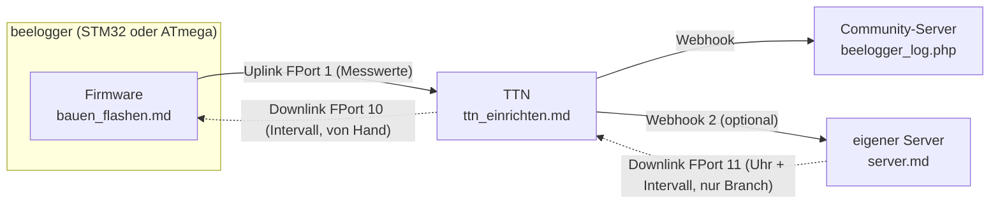

# beelogger STM32 – LoRaWAN-Firmware (PlatformIO)

Die beelogger-Firmware **STM32_LORA_260705** von [beelogger.de](https://beelogger.de) als PlatformIO-Projekt für VS Code, mit Erweiterungen. Gefundene Fehler werden behoben und dokumentiert, damit die beelogger-Entwickler sie übernehmen können.

**Download für die Arduino IDE:** [beelogger_STM32_LORA_261107.zip](https://github.com/desiue/beelogger-stm32/releases/download/STM32_LORA_261107/beelogger_STM32_LORA_261107.zip) ([Release](https://github.com/desiue/beelogger-stm32/releases/tag/STM32_LORA_261107)) – Sketch-Ordner wie bei beelogger.de, ohne Schlüssel. Neu bauen mit `scripts/lieferpaket.sh`.

**Übersicht: was geht wohin** (Einzelheiten in [Architektur](docs/architektur.md))

## Wo fange ich an?

| Ich will … | Seite |
|---|---|
| verstehen, wie die Daten vom Logger zum Server und zurück laufen | [Architektur](docs/architektur.md) |
| die Firmware auf einen STM32-Logger bringen | [Bauen und flashen](docs/bauen_flashen.md) |
| den Logger in TTN anlegen | [TTN einrichten](docs/ttn_einrichten.md) |
| wissen, ob ABP oder OTAA | [ABP oder OTAA](docs/abp_otaa.md) |
| Uhrzeit und Intervall vom eigenen Server schicken | [Server](docs/server.md) |
| einen ATmega-Logger (Universal 1.x, beeloggerSMD) | [ATmega](atmega_lora/README.md) |
| einen Fehler finden | [Fehlersuche](docs/fehlersuche.md), [Häufige Fragen](docs/fragen.md) |

**Alle Seiten, Änderungen gegenüber dem Original, Dateien im Repo:** [Dokumentation – Übersicht](docs/README.md)

**Doku als Website (mit Suche):** <https://desiue.github.io/beelogger-stm32/> – Stand Branch `p7-serverquittung`, nach Merge `main`.

## Kurz gesagt

- Kompatibel zum Original 260705: Messablauf, Waagenzahl, Payload und beelogger-Server bleiben gleich.
- Neu: Sendeintervall per Downlink, OTAA neben ABP, Fehlerkorrekturen; BluePill und BlackPill.
- Keine Schlüssel im Repo, nur Vorlagen `*.example` ([Schlüssel](docs/README.md#schlüssel)).

## Lizenz

Firmware: (C) R. Schick – beelogger.de, **GNU GPL v3 oder später**, Änderungen unter derselben Lizenz ([`LICENSE`](LICENSE), [Einzelheiten](docs/lizenz.md)). Kein offizielles Projekt von beelogger.de. Original: https://beelogger.de

Stand der Arbeit: [Entwicklung → Stand](docs/entwicklung.md#stand).
