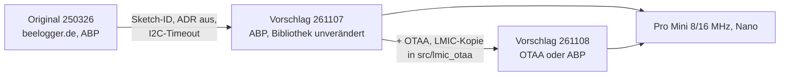

# beelogger LoRa für ATmega328 – Vorschlag 261107

Stand: 19.11.2026 · gilt für: ATmega 261107 (ABP), 261108 (OTAA), Hilfssketch `otaa_join_zuruecksetzen` · geprüft gegen Code: Commit e8aa70d (Änderungen gegen 250326 per diff, OTAA-Ablauf und EEPROM in `Multi_LORA.ino`, Speicher gebaut 19.11.2026)

Der ATmega-LoRa-Sketch **beelogger_LORA_250326** von [beelogger.de](https://beelogger.de/?page_id=200563) (beelogger-Universal 1.x und beeloggerSMD) mit **zwei kleinen Änderungen als Vorschlag**, dazu seit 08.11.2026 ein I2C-Timeout gegen Hänger bei gestörtem Bus. Es sind dieselben zwei Stellen, die mir im STM32-Sketch 260705 aufgefallen sind (siehe [README](../docs/entwicklung.md#gefundene-fehler)). Alles andere ist wie im Original: ABP, Messablauf, Payload, Server.

Dazu als zweiter Ordner eine Fassung mit **OTAA**: [beelogger_LORA_OTAA_261108](#otaa--vorschlag-261108).

**Stand 19.11.2026:** baut für alle drei Boards. Getestet auf einem Steckbrett mit Uno (16 MHz), RFM95 und einem Nano als Uhr ([testaufbau_uno.md](testaufbau_uno.md)). Die **OTAA-Fassung 261108** hat ein Nutzer am 15.11.2026 auf einem echten beeloggerSMD (Pro Mini 8 MHz / 3,3 V) getestet: Join und Daten auf Anhieb ([Ergebnis](#otaa--vorschlag-261108)). Die **ABP-Fassung 261107** ist auf einem echten beelogger noch nicht getestet. Bitte als Vorschlag verstehen. Falls ich etwas übersehen habe, freue ich mich über einen Hinweis.

## Änderungen

| Stelle | Vorher | Nachher | Hintergrund |
|---|---|---|---|
| `Multi_LORA.ino`, `prep_payload()` | `if (LMIC.seqnoUp % 10 == 0)` | `if (LoRaSeqCounter % 10 == 0)` | `LMIC_reset()` löscht die LMIC-Struktur, `seqnoUp` ist danach 0 und wird erst nach `prep_payload()` gesetzt. Nach meinem Verständnis geht die Sketch-ID (4 Byte) deshalb in jedem Uplink mit statt, wie im Kommentar gedacht, in jedem 10. Am STM32 habe ich das in TTN beobachtet, am ATmega nicht. |
| `Multi_LORA.ino`, `setup_LORA()` | – | `LMIC_setAdrMode(0);` | `LMIC_reset()` setzt ADR an. Da der Logger nach jedem Senden schläft, kann er LinkADRReq vermutlich nicht beantworten, und TTN wiederholt sie. Mit der TTN-Einstellung „ADR Disabled“ lässt sich das auch ohne neue Firmware vermeiden. |
| `beelogger_LORA_261107.ino` | `l_ID = 250326` | `l_ID = 261107` | Sketch-ID, damit man am Server sieht, welche Fassung läuft. |
| `beelogger_utility_lora.ino` vor `rtc.begin()`, `beelogger_config.h` | – | `Wire.setWireTimeout(25000, true);`, `#include <Wire.h>` | Seit 08.11.2026: Ohne Timeout hängt der Sketch dauerhaft, wenn der I2C-Bus gestört ist (Test siehe unten bei OTAA). |

Vollständiger Diff: [`aenderungen_gegen_250326.diff`](aenderungen_gegen_250326.diff). Bibliothek: Original 2026_04, **unverändert** (`DISABLE_JOIN` bleibt gesetzt).

## Speicher (arduino-cli 1.5.1, avr-gcc 7.3, Bibliotheken 2026_04, gebaut 19.11.2026, 1 DS18B20, 1 Waage)

| Board | Original 250326 | 261107 |
|---|---|---|
| Pro Mini 8 MHz (beeloggerSMD) | Flash 26 278 B, RAM 1 439 B | Flash 26 298 B, RAM 1 437 B |
| Pro Mini 16 MHz (Universal 1.x) | Flash 26 292 B, RAM 1 439 B | Flash 26 314 B, RAM 1 439 B |
| Nano 16 MHz (Universal 1.x) | Flash 26 292 B, RAM 1 439 B | Flash 26 314 B, RAM 1 439 B |

Verfügbar: 30 720 B Flash (32 KB minus Bootloader), 2 048 B RAM. Der Speicherbedarf bleibt praktisch gleich (+20 B, vor allem der I2C-Timeout). Die absoluten Werte hängen auch vom Ablageort ab, weil die LMIC für ihre Fehlermeldungen die Dateipfade einbaut (ein frischer Klon unter einem längeren Pfad: 26 406 B). Auch die Arduino IDE oder eine eigene `Config_MULTI.h` ergeben etwas andere Werte.

## OTAA – Vorschlag 261108

Ordner `beelogger_LORA_OTAA_261108/`: derselbe Sketch wie 261107, zusätzlich mit OTAA. Umschalten in `Config_LORA.h`: `#define LORA_OTAA 1` (OTAA, Vorgabe in diesem Ordner) oder `0` (ABP wie bisher). Sketch-ID 261108.

Die beelogger-LMIC ist mit `DISABLE_JOIN` gebaut. Deshalb liegt eine Kopie der LMIC im Sketch-Ordner unter `src/lmic_otaa/`, die Arduino IDE baut `src/` automatisch mit. Die installierte Bibliothek bleibt unverändert, andere Sketche bauen wie bisher. Die Kopie ist dieselbe wie im STM32-Paket:
- `DISABLE_JOIN` aus,
- `LMIC_restoreJoin()`: stellt die Session aus den gespeicherten Join-Werten wieder her,
- Link-Check-Anfrage über `LMIC.lchkReq`.

Ablauf:
- Erstes Senden ohne gültige Session: Join, danach geht der wartende Uplink mit FCnt 0 raus. Für Join und Uplink wartet der Sketch bis 30 s statt 8 s (`JOIN_TM_OUT`). Klappt es nicht, neuer Versuch im nächsten Messzyklus.
- Nach dem Join speichert der Sketch DevAddr, NetID, AppNonce, DevNonce und die RX-Werte im EEPROM ab 0x60 (15 Byte). Die Session-Schlüssel stehen nicht im EEPROM, sie werden vor jedem Senden aus APPKEY neu berechnet. Der Frame-Counter bleibt wie bei ABP in `LoRaSeqCounter` (EEPROM 0x20–0x51, `Multi_LORA.ino:91–92`).
- Reset oder Batteriewechsel: kein neuer Join, die Session kommt aus dem EEPROM, FCnt läuft weiter.
- Alle 144 Uplinks (bei 10 min etwa einmal am Tag) hängt der Sketch einen Link-Check an den Uplink. Bleiben drei Link-Checks in Folge ohne Antwort, joint er neu. Das fängt z. B. ein in TTN gelöschtes oder neu angelegtes Gerät ab.
- Neuer Join auch, wenn andere Schlüssel aufgespielt werden (Prüfsumme über DEVEUI und APPKEY), und vor dem Überlauf des 16-Bit-Zählers (bei 65 000).

TTN: Gerät mit OTAA anlegen, LoRaWAN 1.0.2, Regional Parameters 1.0.2 rev B, Frequenzplan Europe 863-870 (TTN). Wie bei ABP: ADR Disabled, Status periodicity 0 ([TTN-Anleitung](../docs/ttn_einrichten.md)). In `Config_LORA.h` DEVEUI und APPEUI (JoinEUI) mit LSB zuerst, APPKEY mit MSB zuerst eintragen (die TTN-Konsole kann die Reihenfolge umschalten).

### Speicher: welche Sensoren passen?

Ein ATmega328 hat 30 720 B Flash für den Sketch (32 KB minus Bootloader) und 2 048 B RAM. OTAA braucht
rund 2,4 KB mehr Flash als ABP (Grundausbau 28 652 B statt 26 300 B). Ob eine Kombination passt, zeigt die
Tabelle. Gebaut mit `scripts/atmega-speicher-matrix.sh` am 19.11.2026 (arduino-cli 1.5.1, Core arduino:avr 1.8.8,
Bibliotheken 2026_04, Pro Mini 8 MHz = beeloggerSMD). „DS18B20“ und „Waagen“ sind die Werte
`Anzahl_Sensoren_DS18B20` und `Anzahl_Sensoren_Gewicht` in `Config_MULTI.h`, alle anderen Sensoren 0, wenn nicht genannt.

| Sensoren | ABP 261107 | OTAA 261108 |
|---|---|---|
| 1 Waage, kein DS18B20 | 25 030 B (81 %) ✓ | 27 392 B (89 %) ✓ |
| 1 Waage, 1 DS18B20 (Vorgabe) | 26 300 B (85 %) ✓ | 28 652 B (93 %) ✓ |
| 1 Waage, 2 DS18B20 | 26 326 B (85 %) ✓ | 28 682 B (93 %) ✓ |
| 2 Waagen, 1 DS18B20 | 27 556 B (89 %) ✓ | 29 906 B (97 %) ✓ |
| 3 Waagen, 1 DS18B20 | 27 322 B (88 %) ✓ | 29 656 B (96 %) ✓ |
| 4 Waagen, 1 DS18B20 | 27 392 B (89 %) ✓ | 29 726 B (96 %) ✓ |
| 4 Waagen, 2 DS18B20 | 27 418 B (89 %) ✓ | 29 754 B (96 %) ✓ |
| 1 Waage, 1 DS18B20 + Si7021 | 26 964 B (87 %) ✓ | 29 316 B (95 %) ✓ |
| 1 Waage, 1 DS18B20 + SHT31 | 27 008 B (87 %) ✓ | 29 344 B (95 %) ✓ |
| 1 Waage, 1 DS18B20 + 2 SHT31 | 27 060 B (88 %) ✓ | 29 412 B (95 %) ✓ |
| 1 Waage, 1 DS18B20 + BH1750 (Licht) | 27 168 B (88 %) ✓ | 29 502 B (96 %) ✓ |
| 1 Waage, 1 DS18B20 + DHT22 | 27 570 B (89 %) ✓ | 29 932 B (97 %) ✓ |
| 1 Waage, 1 DS18B20 + 2 DHT22 | 27 652 B (90 %) ✓ | 30 010 B (97 %) ✓ |
| 1 Waage, 1 DS18B20 + BME280 | 30 280 B (98 %) ✓ | 32 696 B (106 %) ✗ |
| 1 Waage, 1 DS18B20 + 2 BME280 | 30 400 B (98 %) ✓ | 32 800 B (106 %) ✗ |
| 1 Waage, 1 DS18B20 + BME280 + BH1750 | 31 150 B (101 %) ✗ | 33 572 B (109 %) ✗ |
| 4 Waagen, 1 DS18B20 + Si7021 | 28 064 B (91 %) ✓ | 30 406 B (98 %) ✓ |
| 4 Waagen, 1 DS18B20 + SHT31 | 28 104 B (91 %) ✓ | 30 416 B (99 %) ✓ |
| 4 Waagen, 1 DS18B20 + BH1750 | 28 260 B (91 %) ✓ | 30 576 B (99 %) ✓ knapp |
| 4 Waagen, 1 DS18B20 + DHT22 | 28 664 B (93 %) ✓ | 31 016 B (100 %) ✗ |
| 4 Waagen, 1 DS18B20 + Si7021 + BH1750 | 28 858 B (93 %) ✓ | 31 198 B (101 %) ✗ |
| 4 Waagen, 1 DS18B20 + SHT31 + BH1750 | 28 898 B (94 %) ✓ | 31 234 B (101 %) ✗ |
| 4 Waagen, 1 DS18B20 + BME280 | 31 382 B (102 %) ✗ | 33 794 B (110 %) ✗ |

✓ passt, ✗ passt nicht (Arduino IDE meldet „Sketch zu groß“). Prozent abgerundet wie in der Arduino IDE.

**Mit `myDEBUG 0` passt mehr.** In `beelogger_config.h` steht wie im Original 250326 `#define myDEBUG 1`
(Debug-Ausgaben im Seriellen Monitor). Mit `0` entfallen nur diese Ausgaben (`beelogger_config.h`, Abschnitt
„Debug Print Functions“), das spart rund 1,9 KB. Den Join sieht man dann im Seriellen Monitor nicht mehr, nur in TTN.
Gemessen 19.11.2026 wie oben:

| Sensoren, `myDEBUG 0` | ABP 261107 | OTAA 261108 |
|---|---|---|
| 1 Waage, 1 DS18B20 | 24 530 B (79 %) ✓ | 26 762 B (87 %) ✓ |
| 1 Waage, 1 DS18B20 + BME280 | 28 424 B (92 %) ✓ | 30 706 B (99 %) ✓ sehr knapp |
| 1 Waage, 1 DS18B20 + 2 BME280 | 28 546 B (92 %) ✓ | 30 806 B (100 %) ✗ |
| 1 Waage, 1 DS18B20 + BME280 + BH1750 | 29 228 B (95 %) ✓ | 31 510 B (102 %) ✗ |
| 4 Waagen, 1 DS18B20 + DHT22 | 26 768 B (87 %) ✓ | 29 014 B (94 %) ✓ |
| 4 Waagen, 1 DS18B20 + Si7021 + BH1750 | 26 914 B (87 %) ✓ | 29 138 B (94 %) ✓ |
| 4 Waagen, 1 DS18B20 + SHT31 + BH1750 | 26 958 B (87 %) ✓ | 29 182 B (94 %) ✓ |
| 4 Waagen, 1 DS18B20 + BME280 | 29 448 B (95 %) ✓ | 31 760 B (103 %) ✗ |
| 4 Waagen, 1 DS18B20 + BME280 + BH1750 | 30 252 B (98 %) ✓ | 32 556 B (105 %) ✗ |

BME280 mit OTAA bleibt damit 14 B unter der Grenze. Schon 7 Zeichen mehr im Ordnerpfad (siehe unten) reichen, dann passt es nicht mehr.

Hinweise:
- **Mit OTAA und `myDEBUG 1` geht kein BME280.** Bei 4 Waagen passt neben dem DS18B20 genau ein weiterer kleiner Sensor
  (Si7021, SHT31 oder BH1750), nicht zwei. Mit ABP passt der BME280 bei einer Waage, aber nicht zusammen
  mit dem Lichtsensor oder mit 4 Waagen.
- **Der Speicherort zählt (nur OTAA):** Die LMIC-Kopie in `src/lmic_otaa` legt für ihre Fehlermeldungen den
  Dateipfad ab (`src/lmic_otaa/lmic/oslmic.h:46`). Gemessen: je Zeichen im Pfad des Sketch-Ordners etwa 2 B mehr
  Flash und RAM (Pfad 49 Zeichen länger → +96 B). Die Tabelle gilt für einen Pfad mit 50 Zeichen
  (`/tmp/…/beelogger_LORA_OTAA_261108`). Bei z. B. `C:\Users\Name\Documents\Arduino\beelogger_LORA_OTAA_261108`
  (58 Zeichen) kommen gerechnet rund 16 B dazu. Wer knapp über der Grenze liegt, legt den Ordner kürzer ab.
- 2 Waagen brauchen mehr als 3: Der Code hat für 1, 2, 3 und 4 Waagen eigene Zweige, z. B. sendet er
  Beutensensor-Werte nur bis zu zwei Waagen (`Multi_LORA.ino:428`, `beelogger_DS18B20.ino:220–289`).
- RAM: ABP 1 431–1 499 B, OTAA 1 319–1 387 B von 2 048 B (bei 50 Zeichen Pfad, `myDEBUG 1`; mit `myDEBUG 0` rund 30 B weniger).
- Pro Mini 16 MHz und Nano (Universal 1.x) brauchen im Grundausbau 14 B mehr (ABP 26 314 B, OTAA 28 666 B).
- Regenmesser: im LoRa-Sketch schon im Original 250326 auskommentiert (`Sensor_Regen()`), deshalb nicht in der Tabelle.
- Eigene Kombination prüfen: `scripts/atmega-speicher-matrix.sh "DS18B20=1 Gewicht=4 Si7021=1"` (mit `myDEBUG=0` am Anfang ohne Debug-Ausgaben).

**Getestet** auf dem Steckbrett ([testaufbau_uno.md](testaufbau_uno.md)), Uno 16 MHz mit RFM95, TTN, Gerät mit den Einstellungen oben:
- Join beim ersten Senden nach etwa 12 s, Uplink mit FCnt 0 kommt an, RX1-Delay 1 s aus dem Join-Accept.
- Nächster Zyklus und Reset (neu aufgespielt): kein neuer Join, Session aus dem EEPROM, FCnt läuft weiter.
- Link-Check (zum Test bei jedem Uplink): Antwort kommt an. Danach Session in TTN gelöscht: drei Link-Checks ohne Antwort, beim nächsten Senden neuer Join, FCnt wieder ab 0.
- I2C gestört (SDA an GND bzw. offen): Ohne I2C-Timeout hängt der Sketch dauerhaft, auch nach Lösen. Seit 08.11.2026 setzen beide Fassungen (ABP und OTAA) `Wire.setWireTimeout(25000, true)` vor `rtc.begin()` (+34 B bzw. +22 B Flash): Logger sendet weiter, nach Wiederverbinden sofort normal. Bei totem Bus bleibt /INT der Uhr LOW, der Sketch wertet das wie den Service-Schalter (Wecken alle 5 min, Service-Wert 99 bzw. 1).
- Dauerlauf seit 08.11.2026: nach einem Neustart um 11:34 bis 13:03 FCnt 22–31 lückenlos in TTN, kein neuer Join, kein Timeout. Gemessen 19.11.2026 09:53: dieselbe Session seit dem Join am 08.11.2026 10:01 (TTN), FCnt 1318, kein neuer Join. Takt laut `Config_LORA.h:58–61` 10 min, nachts (23–6 Uhr) 30 min. Die 30-min-Phase lag vom 16. bis 19.11. täglich bei etwa 09:15–15:55 Uhr Serverzeit; die Nano-Uhr des Testaufbaus geht demnach (gerechnet) etwa 10 h falsch.

**Getestet von einem Nutzer** (15.11.2026, Rückmeldung per Mail) auf einem beeloggerSMD, Pro Mini 8 MHz / 3,3 V: OTAA-Ordner in der Arduino IDE geöffnet, Gerät in TTN mit OTAA angelegt, Schlüssel eingetragen, aufgespielt. Join auf Anhieb, Daten kommen in TTN an. Speicher laut Arduino IDE: 4 Waagen + 1 DS18B20 = 96 %, zusätzlich ein Si7021 = 99 %. Wie lange der Logger seitdem läuft, ist nicht bekannt.

Diff gegen das Original 250326 (Sketch und LMIC-Kopie gegen die Bibliothek 2026_04): [`otaa_aenderungen_gegen_250326.diff`](otaa_aenderungen_gegen_250326.diff).

## Selbst bauen

**Arduino IDE** (wie beim Original, siehe [Programme laden](https://beelogger.de/systeme/universal/alle_programmcodes/programme_laden/)):
1. Repo holen: `git clone https://github.com/desiue/beelogger-stm32.git` oder auf GitHub „Code → Download ZIP“.
2. beelogger-Bibliotheken installieren, falls noch nicht vorhanden. Gebaut wurde mit dem Paket 2026_04 von [beelogger.de](https://beelogger.de/?page_id=201159), eine Kopie liegt unter [`orginal_firmware_bibliotheken/beelogger_arduino_libs_2026_04/`](../orginal_firmware_bibliotheken/beelogger_arduino_libs_2026_04/).
3. Ordner `atmega_lora/beelogger_LORA_261107/` öffnen (`beelogger_LORA_261107.ino`). Für OTAA stattdessen `atmega_lora/beelogger_LORA_OTAA_261108/`, die LMIC-Kopie in `src/` wird automatisch mitgebaut.
4. Eigene `Config_LORA.h` und `Config_MULTI.h` hineinkopieren. Die Dateien im Ordner sind die Platzhalter aus dem Download.
5. Board wie beim Original wählen: beeloggerSMD = Arduino Pro Mini 3,3 V 8 MHz, Universal 1.x = Pro Mini 5 V 16 MHz oder Nano. Hochladen.

Wer schon einen eigenen Sketch 250326 hat, kann stattdessen nur die zwei Zeilen aus der Tabelle oben ändern.

**PlatformIO** (nur zum Prüfen, ob es baut und in den Speicher passt): im Ordner `atmega_lora/` `pio run` aufrufen (Umgebungen `promini8`, `promini16`, `nano`). Die Bibliotheken kommen aus dem Repo. Aufgespielt wird mit der Arduino IDE.

Der Frame-Counter liegt im EEPROM. Beim Aufspielen über den Bootloader (USB-Seriell, wie üblich) bleibt er erhalten. Ein ISP-Programmer kann das EEPROM löschen. Dann den Zähler mit `Set_LORA_Seq` aus dem Original-Paket setzen oder in TTN zurücksetzen.

**OTAA: neuen Join erzwingen.** Wer den Join nochmal testen will: Beim Aufspielen über den Bootloader bleibt die gespeicherte Session erhalten, der Logger joint also nicht neu. Zwei Wege:
- Neue Schlüssel: neues Gerät in TTN anlegen und DEVEUI/APPKEY im Sketch ändern. Die Prüfsumme passt dann nicht mehr, der Logger joint beim nächsten Senden neu.
- Session löschen: den Sketch [`otaa_join_zuruecksetzen/`](otaa_join_zuruecksetzen/otaa_join_zuruecksetzen.ino) einmal hochladen (9600 Baud; er ist gleich nach dem Start fertig, die Ausgabe zeigt „OK“), danach wieder den OTAA-Sketch aufspielen. Der Sketch setzt die DevAddr im EEPROM (Adresse 0x60) auf 0, das heißt „keine gültige Session“. Der Frame-Zähler bleibt erhalten, TTN setzt ihn mit dem Join zurück. Der Sketch ist für Uno und Pro Mini 8 MHz übersetzt, aber **noch nicht an einem Gerät ausprobiert** (Stand 19.11.2026; am Uno des Testaufbaus nicht, weil dort der Dauerlauf mit derselben Session läuft).

## Test auf einem Logger

1. In TTN unter Live data einen Uplink vor und einen nach dem Aufspielen vergleichen:
   - FCnt läuft weiter (kein Sprung auf 0),
   - der Uplink hat das ADR-Bit nicht mehr (in den Uplink-Details `"adr": false` oder kein `adr`),
   - Payload-Länge: die Sketch-ID kommt nur noch bei jedem 10. FCnt mit, die übrigen Uplinks sind 4 Byte kürzer.
2. Am beelogger-Server: Werte kommen wie bisher, die Sketch-ID zeigt 261107.
3. Einen Tag laufen lassen und in TTN die Zahl der Downlinks ansehen. Mit den Einstellungen aus der [TTN-Anleitung](../docs/ttn_einrichten.md) (ADR Disabled, Status periodicity 0) sollten kaum noch welche kommen.

Wenn etwas anders aussieht als hier beschrieben, bitte melden. Dann habe ich mich vermutlich getäuscht.

Getestet habe ich ab 08.11.2026 auf einem Steckbrett mit Uno, RFM95 und einem Nano als Uhr: [testaufbau_uno.md](testaufbau_uno.md).

## Lizenz

GPL v3 wie das Original, © R. Schick / Thorsten Gurzan, beelogger.de.
