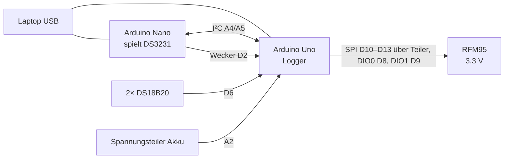

# Testaufbau: Arduino Uno + RFM95, Nano als Uhr

Steckbrett-Aufbau zum Testen des Sketches `beelogger_LORA_261107` ohne beelogger-Platine.
Stand 08.11.2026, ABP-Senden an TTN damit getestet.



## Teile

- Arduino Uno (Nachbau mit CH340, DIP-ATmega328P)
- RFM95-Funkmodul (3,3 V)
- Arduino Nano (Nachbau, alter Bootloader) als Ersatz für den DS3231, Sketch [`testaufbau/ds3231_nachbildung`](testaufbau/ds3231_nachbildung/ds3231_nachbildung.ino)
- 2× DS18B20, 1× 4,7 kΩ
- Spannungsteiler für die „Akku“-Messung
- Teiler 1 kΩ/2 kΩ für die SPI-Leitungen zum RFM95

## Pinbelegung

### RFM95 an Uno

| RFM95 | Uno | Hinweis |
|---|---|---|
| VCC | 3,3 V | |
| GND | GND | |
| SCK | D13 | über Teiler 1 kΩ/2 kΩ (5 V → 3,3 V) |
| MOSI | D11 | über Teiler 1 kΩ/2 kΩ |
| NSS | D10 | über Teiler 1 kΩ/2 kΩ |
| MISO | D12 | direkt |
| DIO0 | D8 | direkt; Wackler zeigt sich als `.tout` im seriellen Log |
| DIO1 | D9 | direkt |
| RST | – | offen |

### Nano als DS3231 an Uno

| Nano | Uno | Zweck |
|---|---|---|
| A4 | A4 | SDA |
| A5 | A5 | SCL |
| D2 | D2 | /INT (Wecker), Nano zieht nur nach GND |
| GND | GND | gemeinsame Masse |

Kein 5 V verbinden: Beide werden über USB versorgt. Pull-ups sind nicht nötig, die internen reichen.

### Sensoren

| Was | Uno | Hinweis |
|---|---|---|
| DS18B20 Daten (beide) | **D6** | 4,7 kΩ nach 5 V. Mit `UNI_2X` (Standard) ist D6 der 1-Wire-Pin, nicht D3 |
| DS18B20 VCC / GND | 5 V / GND | |
| Spannungsteiler „Akku“ | A2 | von 5 V, A2 höchstens 5 V |
| „Solar“ | A3 | auf GND (0 V) |
| Waage | – | keine, sendet Platzhalter |

D2 nicht mehr auf GND legen. Ohne Uhr war D2 an GND der Ersatzbetrieb über den Arbeitsschalter: Der Uno sendet dann einmal und danach 30 min nicht.

## Abweichungen der Bau-Kopie vom Paket

Die Bau-Kopie mit Schlüsseln liegt in `lokal/beelogger_LORA_261107/` (gitignored). Sie unterscheidet sich vom Paket nur hier:

1. `beelogger_config.h` nach dem Block `Pins Spannungen messen`: Der Uno (DIP) hat kein A6/A7.
   ```c
   #if defined(ARDUINO_AVR_UNO)   // lokaler Test: Uno (DIP-Chip) hat kein A6/A7
   #undef Batterie_messen
   #undef Solarzelle_messen
   #define Batterie_messen    A2
   #define Solarzelle_messen  A3
   #endif
   ```
2. `Config_MULTI.h`: Eichung `Kalib_Spannung = 5180` und `Kalib_Bitwert = 3087`. Gemessen wurden 5,18 V am 5-V-Pin mit Rohwert 3087. Bei anderem Teiler neu eichen: mit 1000/100 bauen, dann gilt Rohwert = angezeigte Volt × 100.
3. `Config_MULTI.h`: `Beute1 8`, damit der erste DS18B20 als Stocktemperatur gesendet wird. Mit `Beute1 0` sendet der Sketch die Temperatur der Uhr (bei der Nachbildung fest 20,00 °C).
4. `Config_LORA.h`: ABP-Schlüssel des TTN-Geräts. Anlegen mit [`scripts/ttn-abp-anlegen.py`](../scripts/ttn-abp-anlegen.py).

Der zweite DS18B20 wird mit `Anzahl_Sensoren_DS18B20 1` nicht gesendet. Bei Single (eine Waage) erlaubt die Sensormatrix nur Nr. 1–8.

## Bauen und Flashen

```sh
# Uno (Logger)
arduino-cli compile --fqbn arduino:avr:uno \
  --libraries orginal_firmware_bibliotheken/beelogger_arduino_libs_2026_04 \
  --output-dir lokal/build_uno lokal/beelogger_LORA_261107
arduino-cli upload -p /dev/ttyUSB2 --fqbn arduino:avr:uno --input-dir lokal/build_uno

# Nano (Uhr), alter Bootloader
arduino-cli compile --fqbn arduino:avr:nano:cpu=atmega328old \
  --output-dir lokal/build_nano atmega_lora/testaufbau/ds3231_nachbildung
arduino-cli upload -p /dev/ttyUSB3 --fqbn arduino:avr:nano:cpu=atmega328old --input-dir lokal/build_nano
```

Die Portnummern hängen von der Steckreihenfolge ab. Beide Boards haben einen CH340 (`1a86`).

Vor dem Flashen das serielle Log des Ports stoppen: `PORT=/dev/ttyUSB2 scripts/seriell-log.sh stop`.

## Prüfen

- Log: `PORT=/dev/ttyUSB2 scripts/seriell-log.sh`, ebenso für den Nano. Ansehen mit `grep -a USB2 ~/beelogger-logs/seriell.log`.
- Öffnen des Ports setzt das Board zurück (DTR). Reihenfolge: zuerst den Nano, dann den Uno, damit der Uno Uhrzeit und Alarm neu schreibt.
- Zyklus, wie er laufen soll:
  - Nano: `Alarm 1` → `/INT LOW`
  - Uno: `Loop` … `TX!` → `Wakeup:hh:mm`
  - Nano: `/INT frei`, `Alarm1 hh:mm:00`
  - Tags alle 10 min, nachts (23–6 Uhr) alle 30 min.
- Die Uhr der Nachbildung steht nach dem Start auf der Übersetzungszeit. Der Uno stellt sie auf seine eigene, falls die später ist. Die Uhrzeit weicht dann ab, das spielt keine Rolle.
- TTN: `scripts/ttn-status.sh beeloggeratmega01 uno-test01`.
- 1-Wire-Fehlersuche: [`testaufbau/onewire_scan`](testaufbau/onewire_scan/onewire_scan.ino) auf den Uno flashen (sucht an D6, zeigt Adressen und Temperaturen). Danach den Logger-Sketch wieder aufspielen.
