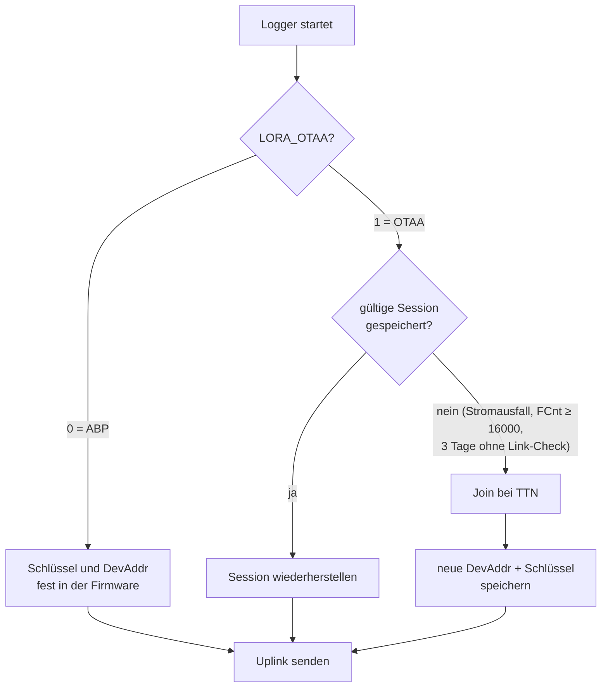

# ABP oder OTAA

[← Übersicht](README.md)

Stand: 09.11.2026, Abschnitt „ABP nach Stromverlust“ 21.11.2026 (Ursache gemessen 19:29 MEZ) · gilt für: STM32 261107 (Stromverlust-Messung: 261119 und 261119 mit Include-Fix) · geprüft gegen Code: Commit 80673f1 (danach bis 9a536c5 in `src/` nur Kommentare und Solar-Vorgabe in `Config_LORA.h.example`, geprüft 19.11.2026)




**ABP** (Activation by Personalization): DevAddr und Sitzungsschlüssel stehen fest in der Firmware. Das Gerät sendet sofort.
**OTAA** (Over-the-Air Activation): In der Firmware steht nur ein Stammschlüssel (AppKey). Beim Start meldet sich das Gerät an („Join“), TTN vergibt DevAddr und Sitzungsschlüssel neu.

| | ABP | OTAA |
|---|---|---|
| Start | sendet sofort | Join beim ersten Start und nach Stromausfall: ein Downlink, ca. 1 s länger wach (gemessen: 19 s statt sonst ca. 18 s mit 4 Waagen) |
| Gateway beim Start | egal | muss erreichbar sein, sonst kein Join und kein Uplink |
| Schlüssel | Sitzungsschlüssel fest, gelten für immer | bei jedem Join neu; im Gerät nur AppKey |
| Zähler nach Akku-ab | fängt bei 0 an; mit „Resets frame counters“ nimmt TTN den neuen Zähler sofort an (neue Session), **sofern das Uplink keine fehlerhafte MAC-Antwort trägt** (gemessen 21.11.2026, siehe [unten](#abp-nach-stromverlust-gemessen)); sonst verwirft TTN still alle Pakete bis zum alten Stand | neuer Join, neue Session – kein Zähler-Reset in TTN nötig |
| TTN-Einstellungen (Rx1/Rx2) | müssen genau zur Firmware passen, sonst Downlink-Schleife; Änderung erst nach „Reset session and MAC state“ | kommen mit dem Join-Accept ins Gerät |
| Downlinks (Sendeintervall, FPort 10) | ja, mit neuer Firmware (alte FW wertet keine aus) | ja |
| Netzausfall erkennen | nein | ja: 1 Link-Check pro Tag, nach 3 Tagen ohne Antwort Neu-Join (kostet 1 Downlink/Tag von 10 erlaubten) |
| Gerät in andere TTN-App umziehen | neu flashen | in TTN neu anlegen, Join |
| Boards | Blue und Black | Blue und Black |
| Strom | – | gleich (beelogger08: Schlaf 18,1 µA, wach 24–34 mA, wie mit alter FW) |
| Strom ohne Gateway | höchstens 8 s pro Zyklus auf Antwort warten | Join-Versuch bis 60 s in **jedem** Zyklus (nach Stromausfall ohne Gateway oder nach 3 Tagen Netzausfall). Geschätzt ca. 150 statt 44 mAh/Tag bei 5 min, nicht gemessen |
| Zählerüberlauf | Uplink-Zähler springt nach 16384 auf 0 (bis Firmware 230711: 16382; bei 5 min ca. alle 57 Tage, bei 15 min ca. alle 170 Tage) → „Resets frame counters“ in TTN dauerhaft nötig; ob TTN die Pakete nach dem Überlauf annimmt, ist ungeprüft (nach der Stromverlust-Messung zu erwarten, sofern keine fehlerhafte MAC-Antwort im Uplink steht) | Neu-Join bei FCnt 16000, kein Überlauf |
| DevAddr | fest | neu bei jedem Join (beelogger011: 260BF6FE → 260BE069). Für den beelogger-Server unkritisch: Er bekommt die Daten über Payload-Formatter und Webhook der jeweiligen TTN-App, die DevAddr spielt dabei keine Rolle |

**Downlinks gehen auch mit ABP.** LoRaWAN öffnet nach jedem Uplink zwei Empfangsfenster (Rx1, Rx2), egal ob das Gerät per ABP oder OTAA aktiviert wurde. Die Firmware wertet Downlinks auf FPort 10 in beiden Varianten mit demselben Code aus (`onEvent`, `EV_TXCOMPLETE`). Getestet am 06.11.2026 mit ABP: beelogger09 (Black) bekam `0F`, Log `DL Port 10: 15`, nächste Weckzeit 15 min später (`logs/2026-11-06_beelogger09_downlink_15min.log`); beeloggerblue05 (Blue) ebenso. Dass Downlinks mit ABP oft nicht ankommen, liegt an den TTN-Einstellungen, nicht an ABP: Rx1-Delay und Rx2-Datenrate müssen zur Firmware passen, und alte Geräte haben oft einen hohen Downlink-Zähler (FCntDown) aus der Downlink-Schleife – dann verwirft das Gerät den Downlink. Abhilfe: „Reset session and MAC state“ und Downlink-Zähler auf 0 (siehe [TTN-Anleitung](ttn_einrichten.md)). Die alte Firmware (vor 261106) wertet gar keine Downlinks aus.

## ABP nach Stromverlust (gemessen)

Nach einem Stromverlust (Akku ab) beginnt ein ABP-Logger wieder bei FCnt 0. Flashen bei angeschlossenem Akku setzt den Zähler nicht zurück ([Bauen und Flashen](bauen_flashen.md)). Mit „Resets frame counters“ (`resets_f_cnt` = true) nimmt TTN den niedrigeren Zähler sofort an und beginnt eine neue Session. Das gilt nur, wenn das Uplink keine MAC-Antwort enthält, zu der TTN keine Anfrage kennt. Sonst verwirft der TTN Network Server alle Pakete ohne Ereignis, bis der FCnt über dem letzten angenommenen Stand liegt.

Messung 21.11.2026, Black Pill F411, Firmware STM32_LORA_261119, ABP, Intervall 5 min, Gateway-Mitschnitt (Puffer des Gateways) und TTN-Ereignisse, ohne Eingriff über die TTN-API:

| TTN-Stand vorher | nach dem Neustart verworfen (am Gateway angekommen, CRC ok) | erstes angenommenes Paket | Ausfall |
|---|---|---|---|
| 2 | FCnt 0–2 | FCnt 3 | ca. 15 min |
| 21 | FCnt 0–21 (lückenlos) | FCnt 22 | ca. 1 h 48 min |

**Gegenprobe mit Fix (gemessen 21.11.2026, 20:48 MEZ):** Black Pill F411, STM32_LORA_261119 mit Include-Fix, ABP, `resets_f_cnt` true. TTN-Stand vorher FCnt 18, Akku ab/an (POR im Seriell-Log, `LoRa-frame counter: 0`), TTN nahm FCnt 0 im ersten Uplink an (Zeitstempel 19:48:39 UTC, Ausfall 0 Pakete).

**Ursache (gemessen 21.11.2026):** Jedes Uplink dieser Messung trug in den FOpts `07 03`, eine NewChannelAns ohne Anfrage (am Gateway mitgeschnitten, TTN-Ereignis `ns.mac.command.process.fail`, `cid` 7). Grund war die lokale `Config_LORA.h` mit `#include <lmic.h>`: Sie holte den LMIC-Header aus `lib/`, gelinkt wurde aber die angepasste LMIC aus `src/lmic_otaa/` mit dem Zusatzfeld `lchkReq` in `lmic_t` (`src/lmic_otaa/lmic/lmic.h:218`). Dadurch schrieb `LMIC.dn2Dr = DR_SF9` (`src/STM32_LORA.ino:290`) den Wert 3 in `snchAns`. Nebenbei blieb die Rx2-Datenrate so auf der LMIC-Vorgabe SF12 (`src/lmic_otaa/lmic/lmic.c:2259`, `lorabase.h:91`), TTN sendet in Rx2 aber mit SF9: Downlinks konnten nur in Rx1 ankommen. Nach dem Fix gemessen 21.11.2026 (Board 3, ABP): FPort-10-Downlink in Rx1 gesendet (TTN `rx1: true`) und ausgeführt (`DL Port 10: 10`, nächste Weckzeit 10 min später); Rx2 lässt sich von TTN aus nicht erzwingen und ist ungeprüft. Seit dem Fix bindet der Sketch `src/lmic_otaa/lmic.h` vor `Config_LORA.h` ein (`src/STM32_LORA_260705.ino`), daher wirkt eine alte Config mit `<lmic.h>` bei PlatformIO nicht mehr (Build byte-gleich). In der Arduino IDE bricht ein Paket mit alter Config (`<lmic.h>`, `<hal/hal.h>`) dagegen beim Linken mit „multiple definition“ ab (gemessen 21.11.2026, arduino-cli, Core STM32 2.6.0, Black Pill F411CE, Bibliotheken 2026_04: 85 Meldungen, auch mit dem Include-Fix); still falsch war es nur bei PlatformIO. Das Paket `beelogger_STM32_20261108.zip` von beelogger.de (`STM32_LORA_261107_OTAA`) hat schon die richtige Config. Gegenprobe mit gleichem Gerät (TTN-Stand 55), Firmware mit Fix, Akku dran: FCnt 4 ohne FOpts, TTN nahm ihn sofort an (`session.started_at` 2026-11-21T18:29:14Z). Der Feld-Logger Q5 (Firmware nicht geprüft, 21.11.2026) zeigt das Verwerfen nicht: TTN nahm FCnt 0 nach einem Neustart sofort an.

Im Fehlerfall: Ausfall ≈ (alter Stand + 1) × Intervall. Beispiel (gerechnet, nicht gemessen): Stand 10 000 bei 15 min Intervall ergibt rund 100 Tage ohne Daten. Mit OTAA tritt das nicht auf, weil nach dem Stromverlust ein neuer Join mit neuer Session folgt.

**Warum beide:** Die vorhandenen Feldgeräte laufen mit ABP und sollen nach dem Update ohne Neuanlage in TTN weiterlaufen. Neue Geräte sollen OTAA nutzen: sicherer, weniger Fehlerquellen bei den TTN-Einstellungen, und ein Netzausfall wird erkannt. Beides aus einer Codebasis, damit Korrekturen nur einmal nötig sind.

OTAA-Gerät in TTN anlegen: LoRaWAN 1.0.2, RP 1.0.2 rev B, Frequenzplan EU_863_870_TTN, ADR aus. Die Session (DevAddr, Nonces, Rx-Werte, 4 × 32 Bit) liegt bei der BlackPill in RTC-Backup-Registern 10–13, beim BluePill in der letzten Flash-Seite laut Chip (F103CB: 0x0801FC00; geschrieben nur bei Änderung: Join, 1 Link-Check/Tag, Löschen; liegt die Seite im Programm, wird nichts gespeichert). Details: [speicher.md](speicher.md). Sie übersteht den Tiefschlaf; die Sitzungsschlüssel werden daraus neu berechnet und nicht gespeichert. Neu-Join nach Stromausfall (POR), unbekanntem Frame-Zähler, FCnt ≥ 16000 (vor dem Überlauf des 14-Bit-Zählers), ungültiger Prüfsumme der Session oder 3 Tagen ohne Link-Check-Antwort.

Mitschnitt OTAA (beelogger08, BlackPill, nach Akku ab/an):
```
Name: beelogger08 UID: 3534393233375105006E0030 DevAddr: 00000000
POR
...
LoRa-frame counter: 0
OTAA: Join
546276: Joining
1045852: Joined DevAddr: 638256495        (= 0x260B056F)
1180909: TX done!
 Weckzeit 01.01.2022 00:04:59
  LoRaSeq_Nr:1 Interval: 5min  DL: 0min  t-on: 19  sw: 0 0
```
Nach einem normalen Neustart (Reset, Tiefschlaf) zeigt die Startzeile die gespeicherte DevAddr, und es gibt keinen Join.

TTN-Live-Daten als Beispiel: OTAA mit zwei Joins (Join-Request, Join-Accept, erster Uplink FCnt 0) in `ttn/beispiele/2026-11-06_beelogger08_otaa_live_data_join.json` (TTN-Ereignis-API, ohne Schlüssel, Standorte und Gateway-Token). ABP: `ttn/beispiele/` – z. B. `2026-11-06_beelogger09_live_data_2h.json` (Uplinks mit dekodierter Payload) und `…_downlink_15min.json` (Intervall-Downlink). Payload-Decoder: `ttn/payload_decoder_ttn.js`.

