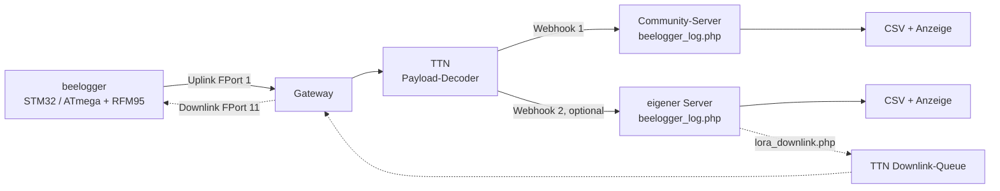
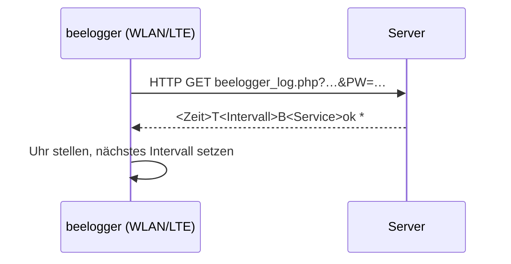
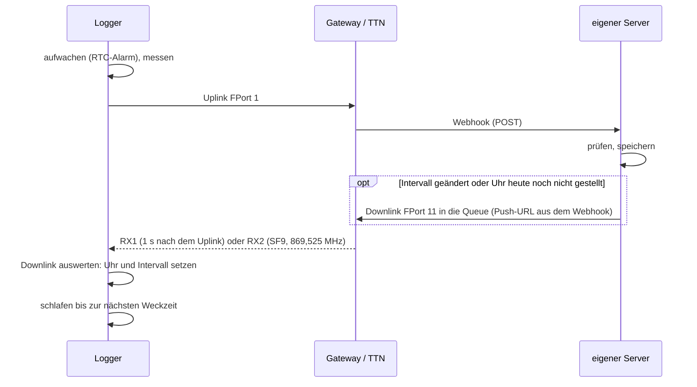

# Architektur: wie die Messwerte vom Bienenstand auf den Server kommen

Stand: 08.11.2026 · gilt für: STM32 261107, ATmega 261107/261108 · geprüft gegen Code: Commit f1a9e0c
(Rückkanal FPort 11: Branch `p7-serverquittung`, noch nicht in `main`)

## Überblick

Ein beelogger misst Gewicht, Temperaturen, Feuchte und Akkuspannung, schläft dazwischen und sendet die Werte
in einem festen Takt. Die LoRa-Variante schickt sie per Funk (LoRaWAN) an ein Gateway in der Nähe. Von dort
gelangen sie über **The Things Network (TTN)** und einen **Webhook** zum beelogger-Server, der sie speichert und
anzeigt. Anders als bei WLAN/LTE gibt es keine direkte Antwort des Servers. Uhrzeit und Sendeintervall kommen
deshalb, wenn gewünscht, über einen eigenen **Downlink** zurück zum Logger.

## Datenweg LoRa

- **Uplink:** Der Logger sendet unbestätigt auf FPort 1 (EU868, SF7, 14 dBm, ADR aus). Die Nutzdaten sind
  etwa 18–26 Byte groß, ein Uplink belegt den Funkkanal etwa 72–82 ms. Format: [payload.md](payload.md).
- **TTN** entschlüsselt die Nachricht, der Payload-Formatter (Decoder) macht daraus benannte Felder.
  Eine TTN-Application kann **mehrere Webhooks** haben. So landen dieselben Daten gleichzeitig auf dem
  Community-Server und, falls vorhanden, auf einem eigenen Server.
- **Webhook:** TTN schickt pro Uplink einen HTTP-POST (JSON, TTN-v3-Format) an
  `…/beelogger_log.php?Passwort=<LogPasswort>&LORA=1`. Einrichtung: [ttn_einrichten.md](ttn_einrichten.md).
- **Rückweg (gestrichelt):** nur dort, wo `lora_downlink.php` eingebunden ist (eigene Erweiterung, siehe
  [server.md](server.md)). Der Community-Server sendet keine Downlinks.

## Datenweg WLAN/LTE zum Vergleich

Die WLAN- und LTE-Sketche (nicht Teil dieses Repos) sprechen den Server direkt an und bekommen sofort eine
Antwort:

Bei LoRa beantwortet der Server den Webhook von TTN, nicht den Logger. TTN verwirft diese Antwort.
Der Downlink über FPort 11 ersetzt sie.

| | LoRa | WLAN/LTE |
|---|---|---|
| Übertragung | Funk zum Gateway, TTN, Webhook (POST) | HTTP GET direkt zum Server |
| Rückkanal | nur Downlink, nur direkt nach einem Uplink | Antwort auf jede Anfrage |
| Uhr stellen | per Downlink FPort 11 (optional) | aus jeder Antwort |
| Intervall vom Server | per Downlink FPort 11 (5–60 min) oder von Hand FPort 10 (5–180 min) | aus jeder Antwort |
| Grenzen | TTN Fair Use: ca. 30 s Sendezeit und ca. 10 Downlinks pro Gerät und Tag | Datenvolumen/Strom |

## Ein Sendezyklus

Ein Gerät der LoRaWAN-Klasse A hört nur in den zwei kurzen Empfangsfenstern direkt nach dem eigenen Uplink.
Der Downlink passt meist noch in die Fenster desselben Uplinks (beobachtet am 08.11.2026). Sonst liegt er in
der TTN-Queue und kommt nach dem **nächsten** Uplink. Deshalb trägt FPort 11 das untere Byte des Frame-Counters
und den Abstand der letzten beiden Uplinks mit. Der Logger erkennt so, zu welchem Uplink die Zeit gehört, und
rechnet bei Bedarf den Abstand dazu.

## Bausteine

### Logger
- STM32 BluePill F103CB, BlackPill F411CE/F401CC (F103C8 hat zu wenig Flash und ist im Code gesperrt),
  ATmega328 (Uno/Nano, Ordner `atmega_lora/`). Funkmodul RFM95, Bibliothek LMIC (angepasst, im Sketch-Ordner).
- Aktivierung ABP oder OTAA, umschaltbar mit `#define LORA_OTAA` in `Config_LORA.h` (siehe [abp_otaa.md](abp_otaa.md)).
- Das Sendeintervall berechnet der Logger selbst (Tag/Nacht/Winter/Akku). Ein Fern-Intervall per Downlink
  hat Vorrang (siehe [intervalle.md](intervalle.md)).

### TTN
- Decoder: [`docs/ttn/payload_decoder_ttn.js`](ttn/payload_decoder_ttn.js).
- Webhooks: einer pro Ziel-Server. Für den Rückkanal braucht der Webhook des eigenen Servers einen
  **Downlink API key** (Recht `traffic down write`). TTN schickt dann Push-URL und Key in den Headern
  `X-Downlink-Replace` und `X-Downlink-Apikey` mit.

### Server
- `beelogger_log.php` (Server-Skripte M40_261004): Passwort prüfen, Zeitstempel = Serverzeit (Sekunden 00),
  Waagen temperaturkompensieren, in `beelogger.csv`, `month.csv`, `week.csv` schreiben, Schwarmalarm prüfen.
  Anzeige mit `beelogger_show.php`.
- Der Ordnername bestimmt die Zahl der Waagen: `beelogger`=1, `Duo`=2, `Triple`=3, `Quad`=4, `Penta`=5, `Hexa`=6.
- Gespeichert wird nur mit Mindestabstand zur letzten Zeile (200 s, auf dem Community-Server Oktober–März
  400 s). Details und Ausnahmen: [server.md](server.md).

### Rückkanal (Downlink)
| FPort | Länge | Inhalt | Wer sendet |
|---|---|---|---|
| 10 | 1 Byte | Fern-Intervall in Minuten (5–180), `0` = zurück zur eigenen Logik | von Hand in der TTN-Konsole |
| 11 | 7 Byte | FCnt-Byte, Zeit (4 Byte), Abstand (min), Intervall (min, 5–60, `0` = unverändert) | `lora_downlink.php`, nur bei Änderung oder 1× am Tag |

- Die STM32-Firmware wertet beide aus.
- Die ATmega-Version zeigt Downlinks nur im seriellen Monitor an und wertet sie nicht aus.

## Stromausfall und ungestellte Uhr

- Die LoRa-Logger haben keine Uhrzeit aus dem Netz. Nach einem Stromverlust (Akku ab) startet die RTC der
  STM32-Logger am **01.01.2022 00:00**.
- Solange die Uhr falsch geht, schaltet die Nacht- und Winterlogik zur falschen Zeit. Die Messwerte selbst
  sind nicht betroffen, weil der Server mit seiner eigenen Zeit stempelt.
- Ist `lora_downlink.php` eingebunden, ist die Uhr spätestens am selben Tag wieder richtig: Der Server sendet
  einmal täglich die Zeit. Das Format ist dasselbe wie in der WLAN-Antwort: Ortszeit (MEZ, in der Sommerzeit
  MESZ) als Unixzeit.
- Ohne Rückkanal bleibt die Uhr beim Startwert und läuft von dort weiter. Die Firmware hat keinen anderen Weg,
  die Uhr zu stellen.

## Weiterlesen

- [payload.md](payload.md): Byte-Formate Uplink und Downlink
- [intervalle.md](intervalle.md): wann der Logger sendet
- [server.md](server.md): Speicherregeln, Service-Werte, `lora_downlink.php` einbinden
- [ttn_einrichten.md](ttn_einrichten.md): Gerät, Decoder, Webhooks
- [abp_otaa.md](abp_otaa.md): Aktivierungsarten
