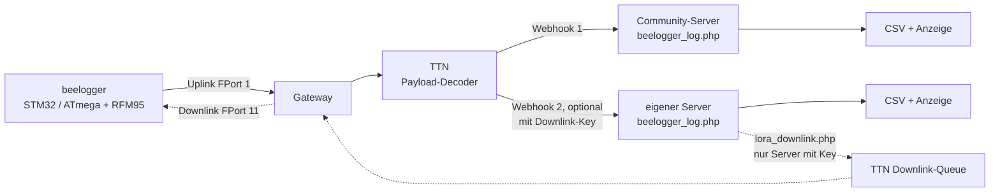
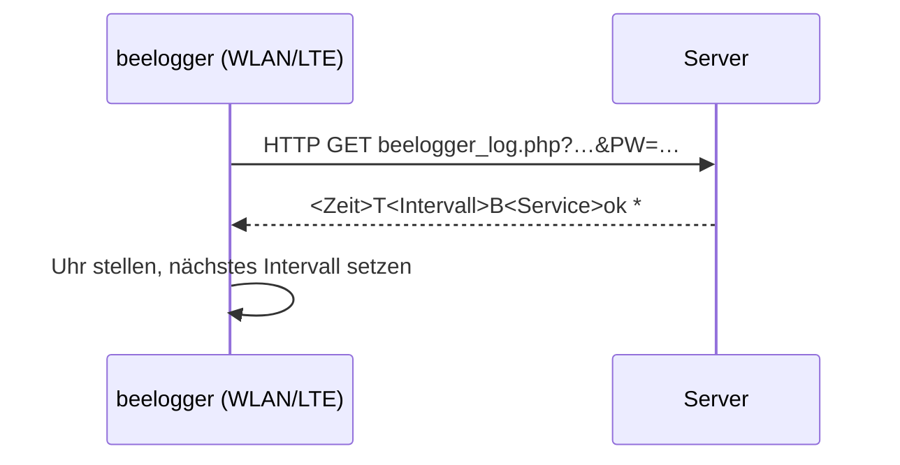
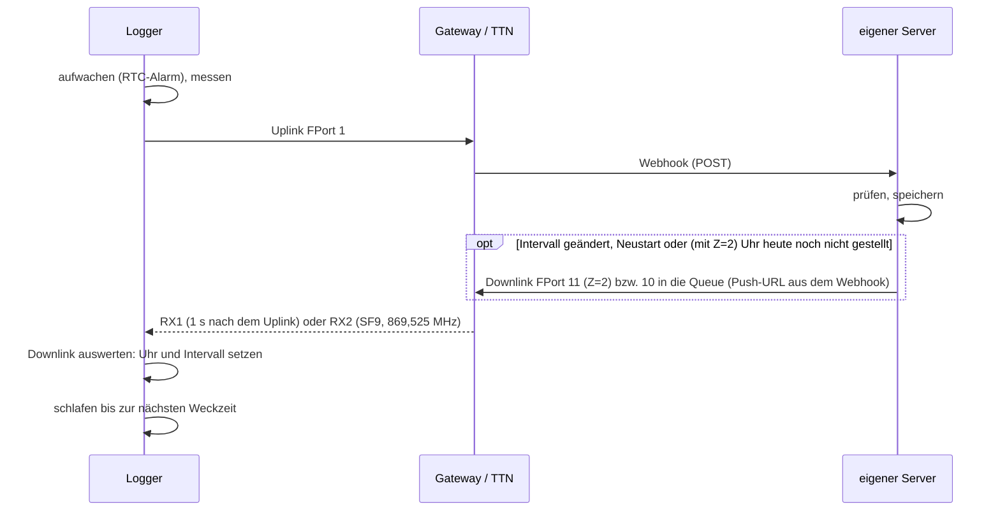

# Architektur: wie die Messwerte vom Bienenstand auf den Server kommen

[← Übersicht](README.md)

Stand: 10.11.2026 · gilt für: STM32 261107, ATmega 261107/261108 · geprüft gegen Code: Commit a3ac566
(Rückkanal FPort 11: Branch `p7-serverquittung`, noch nicht in `main`)

## Überblick

Ein beelogger misst Gewicht, Temperaturen, Feuchte und Akkuspannung, schläft dazwischen und sendet die Werte
in einem festen Takt. Die LoRa-Variante schickt sie per Funk (LoRaWAN) an ein Gateway in der Nähe. Von dort
gelangen sie über **The Things Network (TTN)** und einen **Webhook** zum beelogger-Server, der sie speichert und
anzeigt. Anders als bei WLAN/LTE gibt es keine direkte Antwort des Servers. Uhrzeit und Sendeintervall kommen
deshalb, wenn gewünscht, über einen eigenen **Downlink** zurück zum Logger.

## Datenweg LoRa



- **Uplink:** Der Logger sendet unbestätigt auf FPort 1 (EU868, SF7, 14 dBm, ADR aus). Die Nutzdaten sind
  etwa 18–26 Byte groß, ein Uplink belegt den Funkkanal etwa 72–82 ms. Format: [payload.md](payload.md).
- **TTN** entschlüsselt die Nachricht, der Payload-Formatter (Decoder) macht daraus benannte Felder.
  Eine TTN-Application kann **mehrere Webhooks** haben. So landen dieselben Daten gleichzeitig auf dem
  Community-Server und, falls vorhanden, auf einem eigenen Server.
- **Webhook:** TTN schickt pro Uplink einen HTTP-POST (JSON, TTN-v3-Format) an
  `…/beelogger_log.php?Passwort=<LogPasswort>&LORA=1`. Einrichtung: [ttn_einrichten.md](ttn_einrichten.md).
- **Rückweg (gestrichelt):** nur dort, wo `lora_downlink.php` eingebunden ist (eigene Erweiterung, siehe
  [server.md](server.md)). Der Community-Server sendet keine Downlinks.

## Datenweg WLAN/LTE zum Vergleich

Die WLAN- und LTE-Sketche (nicht Teil dieses Repos) sprechen den Server direkt an und bekommen sofort eine
Antwort:



Bei LoRa beantwortet der Server den Webhook von TTN, nicht den Logger. TTN verwirft diese Antwort.
Der Downlink über FPort 11 ersetzt sie.

| | LoRa | WLAN/LTE |
|---|---|---|
| Übertragung | Funk zum Gateway, TTN, Webhook (POST) | HTTP GET direkt zum Server |
| Rückkanal | nur Downlink, nur direkt nach einem Uplink | Antwort auf jede Anfrage |
| Uhr stellen | per Downlink FPort 11 (optional) | aus jeder Antwort |
| Intervall vom Server | per Downlink FPort 11 (5–60 min) oder von Hand FPort 10 (5–180 min) | aus jeder Antwort |
| Grenzen | TTN Fair Use: ca. 30 s Sendezeit und ca. 10 Downlinks pro Gerät und Tag | Datenvolumen/Strom |

## Ein Sendezyklus



Ein Gerät der LoRaWAN-Klasse A hört nur in den zwei kurzen Empfangsfenstern direkt nach dem eigenen Uplink.
Der Downlink passt meist noch in die Fenster desselben Uplinks (beobachtet am 08.11.2026). Sonst liegt er in
der TTN-Queue und kommt nach dem **nächsten** Uplink. Deshalb trägt FPort 11 das untere Byte des Frame-Counters
und den Abstand der letzten beiden Uplinks mit. Der Logger erkennt so, zu welchem Uplink die Zeit gehört, und
rechnet bei Bedarf den Abstand dazu.

### Im Logger Schritt für Schritt (STM32)

Der STM32 schaltet zwischen zwei Messungen ganz ab (`LowPower.shutdown()`). Das Wecken durch die RTC wirkt
wie ein Reset: Der Sketch beginnt jedes Mal bei `setup()`, nur RTC und Backup-Register behalten ihren Inhalt
([speicher.md](speicher.md)).

```
Wecken (RTC-Alarm oder Arbeitsschalter PA0) → Neustart
setup()
  System_Init()       RTC am Uhrenquarz, ADC 12 Bit
                      nach Stromausfall: Datum 01.01.2022, Frame-Counter 0, OTAA-Session löschen
                      sonst: Werte aus den Backup-Registern holen
  wdt_init()          Software-Watchdog: Merker vom letzten Lauf lesen
  Spannungen_messen() Akku und Solar, je 16 Messungen gemittelt
  System_On()         PB5 = HIGH: Sensoren, Waagen und Funkmodul bekommen Strom
loop()
  Akku-Sparmodus an unter VAlternativ, aus über VAlternativ + 0,1 V
  wenn Akku > VMinimum:
    Arbeitsschalter prüfen (User_Int_req)
    normal:            Sensoren lesen, Waagen messen, Daten_Senden()
    Schalter dauernd:  nur Waagen kurz messen, nicht senden
  System_ShutDown()   nächste Weckzeit setzen (intervalle.md), Werte in Backup-Register,
                      PB5 = LOW, Standby
```

`Daten_Senden()` in `STM32_LORA.ino`: Funkmodul einrichten (Session bzw. Join, Kanäle, ADR aus, RX2 SF9,
SF7/14 dBm), Payload bauen, Frame-Counter setzen, unbestätigt auf FPort 1 senden. Die Firmware wartet bis
`EV_TXCOMPLETE` (also bis nach den Empfangsfenstern), höchstens 8 s, beim Join 60 s. Nur nach
`EV_TXCOMPLETE` zählt sie den Frame-Counter hoch. Danach schaltet sie das Funkmodul ab. Einzelheiten zum
Funkweg: [lorawan.md](lorawan.md).

**Waagen** (`Sensor_Gewicht()`): Mittel aus 10 Lesungen, `(Rohwert − Taragewicht) / Skalierung` in kg.
Weicht das Ergebnis um 0,5 kg oder mehr vom letzten Wert ab, misst die Firmware nach 2 s ein zweites Mal
und nimmt dieses Ergebnis. Eine Waage mit `Taragewicht = 10` wird übersprungen. Antwortet ein HX711 nicht
innerhalb von 2 s, steht `-1` im Feld. Einen Gewichtsalarm mit Extra-Uplink gibt es bei LoRa nicht, der
Rückgabewert von `Sensor_Gewicht()` wird nicht ausgewertet. Temperaturkompensation und Schwarmalarm macht
der Server.

**Watchdog:** Jede Phase (Sensoren 60 s, Funk 100 s, Schlaf vorbereiten 20 s) hat ein Zeitlimit. Hängt
etwas, startet der Logger neu ([entwicklung.md](entwicklung.md), Änderung 8).

## Eigenschaften, die man kennen sollte

- **Kein Zwischenspeicher.** Anders als die WLAN/LTE-Sketche puffert der LoRa-Logger keine Messwerte. Ein
  Uplink, den kein Gateway hört, ist verloren. Die Lücke sieht man auf dem Server.
- **Ein Uplink pro Zyklus.** Jede Messung geht sofort raus, eine Sendung ohne Messung gibt es nicht.
- **Zeitstempel vom Server.** Der Logger schickt keine Uhrzeit mit. Der Server stempelt beim Empfang.
- **Zähler im Logger.** Frame-Counter, Fern-Intervall und OTAA-Session überstehen den Tiefschlaf, nicht
  aber einen Stromausfall ([speicher.md](speicher.md)).
- **Funk nur kurz nach dem Uplink.** Downlinks kommen nur in den zwei Empfangsfenstern direkt danach an.

## Mengengerüst

| | Wert | Quelle |
|---|---|---|
| Payload | 9–28 Byte, typisch 18 (Quad mit Außensensor), mit Sketch-ID 22 | [payload.md](payload.md#länge-und-sendezeit) |
| Frame auf dem Funk | Payload + 13 Byte | [lorawan.md](lorawan.md#aufbau-eines-uplinks) |
| Sendezeit je Uplink | 57–87 ms, typisch 72 ms (SF7) | [lorawan.md](lorawan.md#sendezeit-airtime) |
| Uplinks pro Tag | 288 bei 5 min, 144 bei 10 min (Vorlage) | `WeckIntervall_*` |
| Sendezeit pro Tag | ca. 21 s bei 5 min (TTN-Grenze 30 s) | [lorawan.md](lorawan.md#grenzen) |
| Wachzeit je Zyklus | ca. 15–80 s, steht im Feld `Service` | [payload.md](payload.md#service-feld) |
| Strom (BlackPill F411) | Schlaf 18,1 µA, wach 24–34 mA (gemessen) | [abp_otaa.md](abp_otaa.md) |

## Bausteine

### Logger
- STM32 BluePill F103CB, BlackPill F411CE/F401CC (F103C8 hat zu wenig Flash und ist im Code gesperrt),
  ATmega328 (Uno/Nano, Ordner `atmega_lora/`). Funkmodul RFM95, Bibliothek LMIC (angepasst, im Sketch-Ordner).
- Aktivierung ABP oder OTAA, umschaltbar mit `#define LORA_OTAA` in `Config_LORA.h` (siehe [abp_otaa.md](abp_otaa.md)).
- Das Sendeintervall berechnet der Logger selbst (Tag/Nacht/Winter/Akku). Ein Fern-Intervall per Downlink
  hat Vorrang (siehe [intervalle.md](intervalle.md)).

### TTN
- Decoder: [`docs/ttn/payload_decoder_ttn.js`](ttn/payload_decoder_ttn.js).
- Webhooks: einer pro Ziel-Server. Für den Rückkanal braucht der Webhook des eigenen Servers einen
  **Downlink API key** (Recht `traffic down write`). TTN schickt dann Push-URL und Key in den Headern
  `X-Downlink-Replace` und `X-Downlink-Apikey` mit. Den Key nur in **einem** Webhook eintragen: Nur dieser
  Server sendet Downlinks und bestimmt Intervall und Uhrzeit (siehe [server.md](server.md)).

### Server
- `beelogger_log.php` (Server-Skripte M40_261109, Kopie in `server/M40_261109/`): Passwort prüfen, Zeitstempel = Serverzeit (Sekunden 00),
  Waagen temperaturkompensieren, in `beelogger.csv`, `month.csv`, `week.csv` schreiben, Schwarmalarm prüfen.
  Anzeige mit `beelogger_show.php`.
- Der Ordnername bestimmt die Zahl der Waagen: `beelogger`=1, `Duo`=2, `Triple`=3, `Quad`=4, `Penta`=5, `Hexa`=6.
- Gespeichert wird nur mit Mindestabstand zur letzten Zeile (220 s, auf dem Community-Server Oktober–Februar
  520 s). Details und Ausnahmen: [server.md](server.md).

### Rückkanal (Downlink)
| FPort | Länge | Inhalt | Wer sendet |
|---|---|---|---|
| 10 | 1 Byte | Fern-Intervall in Minuten (5–180), `0` = zurück zur eigenen Logik | von Hand in der TTN-Konsole |
| 11 | 7 Byte | FCnt-Byte, Zeit (4 Byte), Abstand (min), Intervall (min, 5–60, `0` = unverändert) | `lora_downlink.php`, nur bei Änderung oder 1× am Tag |

- Die STM32-Firmware wertet beide aus.
- Die ATmega-Version zeigt Downlinks nur im seriellen Monitor an und wertet sie nicht aus.

## Uhr: wann sie stimmt und wann nicht

Die STM32-Logger haben eine eingebaute Uhr (RTC), die an einem 32-kHz-Uhrenquarz läuft (LSE). Eine
Uhrbatterie gibt es nicht. Die Uhr braucht der Logger für die Weckzeit und, je nach Config, für Tag/Nacht
und Winter (siehe [intervalle.md](intervalle.md)). Die Messwerte selbst stempelt der Server mit seiner
eigenen Zeit, sie sind von einer falschen Logger-Uhr nie betroffen.

**Woher die Uhrzeit kommt:** Die LoRa-Logger bekommen aus dem Funknetz keine Uhrzeit. Gestellt wird die Uhr
nur über den Downlink FPort 11 von `lora_downlink.php` (Webhook-Adresse mit `Z=2`). Ohne diesen Rückkanal läuft sie ab dem Startwert
einfach weiter.

**Format:** wie in der WLAN-Antwort, Ortszeit als Unixzeit, also MEZ (UTC + 1 h) und in der Sommerzeit MESZ
(UTC + 2 h). Der Server rechnet `Empfangszeit + date("Z")`. In der WLAN-Antwort entsteht dasselbe auf
anderem Weg: `beelogger_log.php` zieht `new DateTime('1970-01-01 00:00:00')` ab, und das liegt in der
Zeitzone des Servers eine Stunde vor dem UTC-Nullpunkt.

| Situation | Uhr | wieder richtig |
|---|---|---|
| Normalbetrieb mit `lora_downlink.php` | wird einmal am Tag gestellt (erster Uplink nach Mitternacht) | – |
| Stromausfall (Akku ab) | startet am **01.01.2022 00:00** | beim ersten Uplink nach dem Neustart (Server erkennt den kleineren Frame-Counter) |
| Umstellung Sommer-/Winterzeit (nachts um 2 bzw. 3 Uhr) | geht kurz 1 h falsch | beim ersten Uplink nach der Umstellung (Server merkt sich `date("I")`) |
| ohne Rückkanal | läuft vom Startwert aus weiter | nie |

Wie weit die Uhr ohne Stellen wegläuft, zeigt der Langzeittest seit 08.11.2026: an einer BluePill F103
etwa **6 s pro Tag** nach (gemessen vom 10.11. bis 13.11.2026, jeden Tag +7 s vor dem Stellen, 1 s
Auflösung). Mit dem täglichen Stellen durch `lora_downlink.php` bleibt die Abweichung also unter 10 s.
Ohne Rückkanal sind es etwa 3 min im Monat.
Andere Boards können anders laufen.

**Ohne gestellte Uhr** schaltet die Nacht- und Winterlogik nach Uhrzeit und Monat zur falschen Zeit. Nach
einem Stromausfall gilt sofort „Nacht“ (00:00) und „Winter“ (Januar). Wer keinen Rückkanal hat, nimmt
besser die Umschaltung nach Solarspannung und Temperatur (siehe [intervalle.md](intervalle.md)). Was der
Logger nach einem Stromausfall sonst noch vergisst: [speicher.md](speicher.md).

Fehler bis 08.11.2026 abends (nur Branch): `lora_downlink.php` schickte UTC statt Ortszeit. Die Uhren
gingen im Winter eine Stunde nach. Behoben mit Commit 80673f1.

## Weiterlesen

- [hardware.md](hardware.md): Boards, Pinbelegung, Spannungsmessung
- [lorawan.md](lorawan.md): Funkweg, Frame-Aufbau, Sendezeit
- [payload.md](payload.md): Byte-Formate Uplink und Downlink
- [intervalle.md](intervalle.md): wann der Logger sendet
- [server.md](server.md): Speicherregeln, Service-Werte, `lora_downlink.php` einbinden
- [ttn_einrichten.md](ttn_einrichten.md): Gerät, Decoder, Webhooks
- [abp_otaa.md](abp_otaa.md): Aktivierungsarten
- [speicher.md](speicher.md): Backup-Register, Flash, was nach Stromausfall bleibt
- [fragen.md](fragen.md): häufige Fragen
