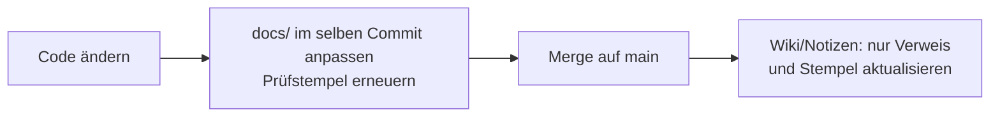

# Doku-Pflege: eine Quelle pro Information

Stand: 08.11.2026 · gilt für: alle Firmware-Varianten in diesem Repo

Rund um den beelogger gibt es Informationen an mehreren Stellen: Code, diese GitHub-Doku, Wikis, Notizen,
Mailverläufe. Sie stammen aus verschiedenen Zeiten und Firmware-Ständen (z. B. 230711, 260705, 261107).
Wer zuerst eine alte Stelle liest, arbeitet leicht mit einem veralteten Wert weiter. Diese Seite legt fest,
welche Quelle gilt und wie die Stellen zusammen aktuell bleiben.

## Welche Quelle gilt

| Rang | Quelle | maßgeblich für |
|---|---|---|
| 1 | **Code** (`src/`, `atmega_lora/`, `server/`), Branch `main` | alles Technische: Werte, Ports, Intervalle, Byte-Formate, Abläufe |
| 2 | **`docs/` und `README.md`** in diesem Repo | Erklärungen, abgeleitet aus dem Code, mit Prüfstempel |
| 3 | Private Wikis/Notizen einzelner Nutzer | nur Privates: Schlüssel, eigene Server, Standorte, Aufbau vor Ort |
| 4 | Mails, Foren, Arbeitsnotizen | Hintergrund und Verlauf, keine Referenz |

Bei einem Widerspruch gilt der Code. Erst nachsehen, dann weiterarbeiten.

**Beispiel:** Eine ältere Beschreibung sagt „Frame-Counter springt bei 16382 auf 0“. Im Code
(`src/STM32_LORA.ino`, `inc_LoRaSeq()`) steht dieser Zweig hinter `#if 0`; aktiv ist
`if (LoRaSeqCounter > 16384) LoRaSeqCounter = 0;`. Die alte Aussage galt bis Firmware 230711
(Zähler im externen EEPROM). Richtig ist also: „bis 230711: 16382, ab 260705: 16384“.

## Prüfstempel auf jeder Seite

Jede Seite in `docs/` beginnt mit einer Zeile wie:

```
Stand: 08.11.2026 · gilt für: STM32 261107, ATmega 261108 · geprüft gegen Code: Commit f1a9e0c
```

- Aussagen, die nur für alte Versionen gelten, bleiben stehen, werden aber markiert:
  „bis 260705: …“.
- Was nur auf einem Branch existiert, heißt „(Branch `p7-serverquittung`, noch nicht in `main`)“.
- Fehlt der Prüfstempel oder ist er älter als die letzte Code-Änderung am Thema, gilt die Seite als ungeprüft.

## Ablauf bei Änderungen



1. Code und betroffene `docs/`-Seite im **selben Commit** ändern.
2. Erst nach dem Merge auf `main` andere Stellen (Wikis, Notizen) nachziehen. Dort möglichst
   **verlinken statt kopieren**: Ein Link auf `docs/payload.md` veraltet nicht, eine kopierte Tabelle schon.
3. Notizen zum Arbeitsstand nennen den Commit statt Werte zu wiederholen.

## Automatische Prüfung

`python3 scripts/doku-check.py` liest wichtige Werte aus dem Code (`VMinimum`, `VAlternativ`,
Akku-Sparintervall, Uplink-FPort, Grenzen der Downlink-Intervalle, Zählergrenzen, Nachtzeiten) und meldet
jede Stelle in `README.md` und `docs/*.md`, an der derselbe Begriff mit einer anderen Zahl steht:

```
ok VMinimum = 3.75
✗  docs/beispiel.md:12: Uplink-FPort = 2, Code (src/STM32_LORA.ino) = 1
```

Vor jedem Commit an der Doku laufen lassen. Neue Werte als Zeile in `PRUEFUNGEN` ergänzen.
Die Server-Abstände (200/110/55 s) stehen in fremdem Code außerhalb des Repos und werden nicht geprüft.
`docs/planung/` bleibt außen vor, weil die Dateien dort ältere Stände beschreiben.
