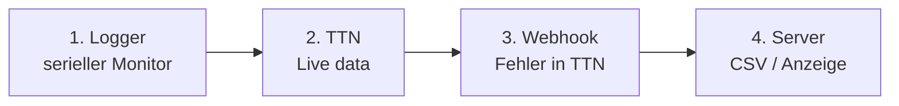

# Fehlersuche

Stand: 08.11.2026 · gilt für: STM32 261107 · geprüft gegen Code: Commit f1a9e0c
(Meldungen aus `src/STM32_LORA.ino`, `src/STM32_LORA_utility.ino`, `src/STM32_LORA_260705.ino`;
Serverantworten aus `beelogger_log.php` M40_261004)

Vorgehen: **von vorn nach hinten** am Datenweg entlang (siehe [architektur.md](architektur.md)).
Erst prüfen, ob der Logger sendet, dann ob TTN empfängt, dann ob der Server speichert.

## 1. Logger: serieller Monitor

FTDI-Adapter an PA9/PA10, **9600 Baud**, 8N1 (siehe [bauen_flashen.md](bauen_flashen.md)). Die erste Zeile
nach dem Start zeigt Firmware-Kennung, Name, Chip-UID und DevAddr. So ist klar, welches Gerät am Kabel hängt.

| Meldung | Bedeutung | Was tun |
|---|---|---|
| `POR` | Start nach Stromausfall (Akku ab/an) | normal; Uhr steht auf 01.01.2022, Zähler ABP auf 0 |
| `OTAA: Join`, `Joining`, `Joined DevAddr: …` | OTAA-Anmeldung, erfolgreich | normal nach `POR` |
| `Joining` ohne `Joined` | kein Join-Accept | Gateway in Reichweite? DevEUI/JoinEUI LSB, AppKey MSB? ([ttn_einrichten.md](ttn_einrichten.md)) |
| `TX done!` | Uplink gesendet, Empfangsfenster vorbei | normal |
| `.tout` | Senden nicht innerhalb der Wartezeit fertig | Funkmodul, Antenne, Verdrahtung prüfen |
| `DL Port 10: 15` | Fern-Intervall 15 min empfangen | normal |
| `DL Port 11: …`, `Uhr gestellt` | Serverquittung empfangen, Uhr gestellt | normal |
| `Link-Check Fehlversuche: n` | OTAA prüft 1× am Tag, ob das Netz antwortet; bei 3 → Neu-Join | bei 1–2 abwarten, Gateway prüfen |
| `I2C: SDA low, takte frei` | ein I2C-Sensor hält den Bus fest, die Firmware gibt ihn frei | Sensor, Kabel, Feuchtigkeit prüfen |
| `WDT: Neustart, Phase n` | eine Wachphase hat zu lange gedauert (1 Sensoren 60 s, 2 LoRa 100 s, 3 Schlaf 20 s) | Phase 1: Sensor; Phase 2: Funk/Join |
| `WDT: ohne I2C-Sensoren` | nach einem Sensor-Hänger einmal ohne I2C-Sensoren gemessen | Sensor prüfen |
| `WDT: Zyklus ausgelassen` | nach LoRa-Hänger oder zwei Neustarts in Folge: diesmal nur schlafen | wenn es dauernd kommt: Funkmodul |
| `WDT: LMIC-Fehler` | die LoRa-Bibliothek hat abgebrochen (`hal_failed()`), z. B. Funkmodul antwortet nicht | Verdrahtung RFM95 (NSS PA4, SPI PA5–PA7) |
| `OTAA: kein Flash frei fuer Session, Join bei jedem Start` | BluePill: Flash-Seite für die Session nicht nutzbar | Board/Build prüfen (Flash ≤ 63 KB) |
| `Weckzeit 01.01.2022 …` | Uhr ungestellt | normal ohne Serverquittung; siehe [intervalle.md](intervalle.md) |

**Payload-Bytes im Log:** Im Block `Data:` stehen die Bytes dezimal ohne Trennzeichen.
`batt.: 16106` heißt 16 und 106 = `0x10 0x6A` = 4202 mV. Das ist kein Fehler.

## 2. TTN: kommt der Uplink an?

TTN-Konsole → Application → End device → **Live data**.

| Zeichen | Ursache | Abhilfe |
|---|---|---|
| nichts zu sehen | Gateway hört nichts, falsche DevAddr/Schlüssel, falscher Frequenzplan | Gateway-Live-Data prüfen; Schlüssel und `LORA_CHANNELS` vergleichen |
| Gateway sieht Pakete, Gerät nicht (ABP) | Zähler liegt weit über dem, was TTN erwartet | Akku kurz ab (Zähler 0) oder in TTN anpassen ([ttn_einrichten.md](ttn_einrichten.md), Abschnitt 5) |
| ABP nach Akkuwechsel verworfen | „Resets frame counters“ aus | einschalten |
| unter jedem Uplink ein Downlink, den niemand geschickt hat | **Downlink-Schleife**: MAC-Einstellungen passen nicht zur Firmware | MAC-Werte wie in [ttn_einrichten.md](ttn_einrichten.md) Abschnitt 7, dann „Reset session and MAC state“ |
| Downlink geplant, kommt nie an | FCntDown in TTN > 65535 | beide Zähler zurücksetzen ([ttn_einrichten.md](ttn_einrichten.md), Abschnitt 5) |
| `decoded_payload` fehlt oder ist falsch | Payload-Formatter fehlt oder ist alt | [`ttn/payload_decoder_ttn.js`](ttn/payload_decoder_ttn.js) eintragen; Bytes mit [payload.md](payload.md) vergleichen |

Hilfsskript: `scripts/ttn-status.sh <app> <device>` zeigt MAC-Einstellungen, offene MAC-Befehle und beide
Downlink-Zähler und warnt bei Problemen.

## 3. Webhook: erreicht TTN den Server?

TTN zeigt Webhook-Fehler in den Live data der Application (Ereignis „Fail to send webhook“).
Nach vielen Fehlern schaltet TTN den Webhook vorübergehend ab.

Antworten von `beelogger_log.php`:

| Antwort | Bedeutung |
|---|---|
| `…ok *` | angenommen (Format `<Zeit>T<Intervall>B<Service>ok *`) |
| `PwErrorT55Dok *` | falsches Passwort im Parameter `Passwort=` |
| `typErrT25Dok *` | Ordnername passt nicht zur Zahl der Waagen in den Daten |

Häufig: URL ohne `&LORA=1`, Tippfehler im Ordnernamen, Passwort mit Sonderzeichen, die in der URL anders
ankommen.

## 4. Server: wird gespeichert?

| Zeichen | Ursache |
|---|---|
| Webhook ok, aber Lücken in der Anzeige | Mindestabstand: weniger als 200 s (Community-Server Okt–März 400 s) seit der letzten Zeile → verworfen. Bei 5-min-Intervall im Winter jeder zweite Wert. Siehe [server.md](server.md). |
| Gewicht springt | Kalibriertemperatur `99.9` im Betrieb gesetzt (nur für Tests), oder Temperaturkompensation falsch |
| Kein Schwarmalarm nach Durchsicht | gewollt: Service 99 schaltet ihn für diese und die nächste Meldung ab |
| Durchsicht-Symbol ohne Durchsicht | Service-Wert über 240 |

Eigener Server mit `lora_downlink.php`: `lora_downlink.log` im Logger-Ordner zeigt jeden Downlink-Versuch.
`kein Downlink-Header (Webhook ohne Downlink API key?)` heißt: Im TTN-Webhook fehlt der Downlink-Key.
