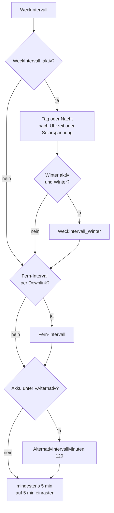

# Intervalle: wann der Logger misst und sendet

[← Übersicht](README.md)

Stand: 10.11.2026 · gilt für: STM32 261107 · geprüft gegen Code: Commit 7ccdb38
(`src/STM32_LORA_utility.ino`, `Alarm_konfigurieren()`; `src/STM32_LORA_260705.ino`, `loop()`;
`src/Config_LORA.h.example`) · FPort 11: Branch `p7-serverquittung`, noch nicht in `main`

## Grundprinzip

Der Logger wacht auf, misst, sendet **bei jedem Aufwachen** einen Uplink und legt sich wieder schlafen.
Wann er das nächste Mal aufwacht, rechnet er vor dem Einschlafen aus und stellt dafür einen Alarm in der
eingebauten Uhr (RTC). Das Intervall ist also gleichzeitig Mess- und Sendeintervall.

Die Weckzeit wird auf **volle 5 Minuten abgerundet** und liegt eine Sekunde davor (z. B. 14:54:59).
Das kürzeste Intervall sind 5 Minuten. Kleinere Werte hebt die Firmware auf 5 an, damit die
LoRaWAN-Regeln (Sendezeit, Fair Use) eingehalten werden.

## Reihenfolge: was gilt

Die Firmware prüft die Regeln nacheinander. Die **letzte zutreffende** Regel setzt das Intervall:

| Rang | Regel | Einstellung (Vorlage `Config_LORA.h.example`) |
|---|---|---|
| 1 (stärkste) | **Akku-Sparmodus:** Akku unter `VAlternativ` (3,8 V), zurück erst über `VAlternativ` + 0,1 V | `AlternativIntervallMinuten` = 120 |
| 2 | **Fern-Intervall** per Downlink FPort 10 oder 11 | 5–180 min (FPort 11: 5–60) |
| 3 | **Winter** | `WeckIntervall_Winter_aktiv` 0, `WeckIntervall_Winter` 60 |
| 4 | **Nacht / Tag** | `WeckIntervall_Tag` 10, `WeckIntervall_Nacht` 30, Nacht 23–6 Uhr |
| 5 | Grundwert, wenn `WeckIntervall_aktiv` = 0 | `WeckIntervall` 10 |

Zusätzlich:
- **Unter `VMinimum` (3,75 V)** misst und sendet der Logger gar nicht mehr und schläft nur
  (im Akku-Sparintervall von 120 min), bis die Spannung wieder steigt.
- **Arbeitsschalter (Service):** Wird der Schalter eingeschaltet (an Pin PA0, mindestens 2 s), sendet
  der Logger sofort eine Meldung mit Service = 99. Solange der Schalter an bleibt, wacht er alle 5 min
  auf (`INTERVAL_STUCK_SWITCH`), misst nur das Gewicht und sendet nicht. Das dauert höchstens
  `USER_INT_TM` Minuten. Die Vorlage hat 180, der Code begrenzt auf 150. Danach geht er in den normalen
  Takt zurück, auch wenn der Schalter vergessen wurde.

Die Werte für 1-Zellen-Li-Ion stehen in `Config_MULTI.h`. Für 6-V- und 12-V-Akkus sind dort
auskommentierte Alternativen.

## Tag und Nacht

Ohne Solarumschaltung: nach der **Uhrzeit**. Nacht ist, wenn die Stunde ≥ `WeckIntervall_Nacht_Anfang` (23) oder
< `WeckIntervall_Nacht_Ende` (6) ist.

Nach der **Solarspannung** (`SOLAR_ZYKLUS_aktiv 1`, Voreinstellung in `Config_LORA.h.example`): Nacht,
solange die Solarspannung unter `SolarSpannung_Sommertag` (1,0 V) liegt. Ersetzt die Uhrzeit-Regel und
funktioniert auch ohne gestellte Uhr.

1,0 V passt nur zum Lademodul mit CN3065 oder TP4056 (Standard ab BlackPill V1.3). Mit der älteren
SPV1040-Ladeschaltung passt der Wert nicht; den richtigen Wert dafür nennt beelogger.de noch nicht
(Auskunft beelogger-Team, 09.11.2026).

## Winter

Standard: nach dem **Monat**. Winter ist, wenn der Monat > `WeckIntervall_Winter_Anfang` (9) oder
< `WeckIntervall_Winter_Ende` (4) ist, also **Oktober bis März**. In der Vorlage ist das aus
(`WeckIntervall_Winter_aktiv 0`).

Alternativ nach der **Temperatur** (`TEMP_ZYKLUS_aktiv 1`): Wintertag, wenn die DS18B20-Temperatur
unter `Temperatur_Wintertag` (8 °C) liegt.

**Wichtig:** Tag/Nacht und Winter nach Uhrzeit oder Monat brauchen eine **gestellte Uhr**. Nach einem
Stromausfall startet die RTC am 01.01.2022 00:00. Dann gilt sofort „Nacht“ und „Winter“, bis die Uhr
stimmt. Gestellt wird sie nur über den Downlink FPort 11 (siehe [architektur.md](architektur.md)).
Ohne diesen Rückkanal sind die Varianten nach Solarspannung und Temperatur die sicherere Wahl.

## Fern-Intervall per Downlink

- **FPort 10** (von Hand in der TTN-Konsole): 1 Byte Minuten, 5–180. `0` schaltet zurück auf die eigene
  Logik. Beispiel: `1E` = 30 min.
- **FPort 11** (automatisch von `lora_downlink.php`): Byte 6 = Intervall 5–60 min. Der Server nimmt dafür
  die Einstellung aus der Web-Konfiguration (`ServerZeitSteuerung()`), also dieselbe, die auch WLAN-Logger
  bekommen. Damit steuert die Weboberfläche auch LoRa-Logger.

Das Fern-Intervall ersetzt Tag/Nacht/Winter, **nicht** den Akku-Sparmodus. Es liegt im RTC-Backup-Register
(Register 5, Bit 9–14, gespeichert als Minuten ÷ 5) und übersteht den Tiefschlaf, aber keinen
Stromausfall. Danach gilt wieder die eigene Logik, bis der nächste Downlink kommt.

Byte-Formate: [payload.md](payload.md).

## Zusammenspiel mit dem Server

Der Server speichert eine Meldung nur, wenn seit der letzten genug Zeit vergangen ist: 220 s, auf dem
Community-Server von **Oktober bis Februar 520 s** (Details: [server.md](server.md)).

| Intervall | normal (220 s) | Okt–Feb auf dem Community-Server (520 s) |
|---|---|---|
| 5 min (300 s) | jede Meldung gespeichert | nur etwa **jede zweite** gespeichert |
| ab 10 min | jede | jede |

Wer im Winter jede Meldung auf dem Community-Server sehen möchte, stellt mindestens 10 min ein, z. B. mit
`WeckIntervall_Winter_aktiv 1` oder serverseitig über das Winterintervall in der Web-Konfiguration
(kommt per FPort 11 an).

## Beispiele

**Vorlage unverändert, Uhr gestellt, 8. November, Logger schläft um 14:55:10 ein:** Tag (14 Uhr),
Winter aus → 10 min. 14:55:11 + 10 min = 15:05:11, abgerundet auf das 5-Minuten-Raster 15:05:00,
minus 1 s → nächste Weckzeit **15:04:59**. Weil abgerundet wird, liegen die Meldungen im festen
Raster xx:x4:59 bzw. xx:x9:59, unabhängig davon, wie lange ein Zyklus gedauert hat.

**Winter aktiv, Uhr gestellt, 8. November, 02:00:** Nacht → 30 min, dann Winter → 60 min.
Es gilt 60 min.

**Akku 3,78 V, Fern-Intervall 15 min:** Akku-Sparmodus hat Vorrang → 120 min.

**Stromausfall, keine FPort-11-Quittung, Winter aktiv:** Uhr steht auf 01.01.2022 → Nacht und Winter →
60 min, auch mittags im Juli.
