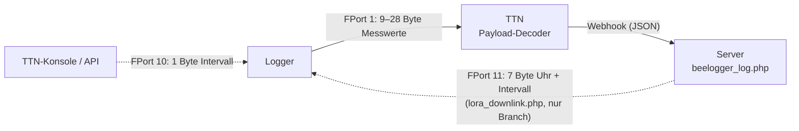

# Payload: was in einer LoRa-Nachricht steht

Stand: 08.11.2026 · gilt für: STM32 261107 (Uplink identisch mit 260705 und ATmega 250326/261107) ·
geprüft gegen Code: Commit f1a9e0c (`src/STM32_LORA.ino`, `prep_payload()`, `onEvent()`;
`docs/ttn/payload_decoder_ttn.js`) · FPort 11: Branch `p7-serverquittung`, noch nicht in `main`

Überblick: [architektur.md](architektur.md)



## Übersicht der Ports

| Richtung | FPort | Länge | Inhalt |
|---|---|---|---|
| Uplink (Logger → Server) | 1 | 9–28 Byte | Messwerte, Header am Ende |
| Downlink (Server → Logger) | 10 | 1 Byte | Fern-Intervall in Minuten |
| Downlink (Server → Logger) | 11 | 7 Byte | Serverquittung: Uhrzeit + Intervall |

Alle Mehrbyte-Werte sind **big endian** (höchstwertiges Byte zuerst).

## Uplink FPort 1

### Aufbau

Die Nachricht besteht aus den Messwerten, die tatsächlich vorhanden sind, und am **Ende** einem
**2-Byte-Header**. Jedes gesetzte Bit im Header sagt: dieses Feld ist dabei. Die Felder stehen in der
Reihenfolge der Bitnummern hintereinander. Fehlt ein Sensor, fehlt sein Feld, und das Bit ist 0.

| Bit | Feld (Decoder) | Byte | Typ | Umrechnung | Wann dabei |
|---|---|---|---|---|---|
| 0 | `TempOut` | 2 | int16 | ÷ 100 → °C | Außentemperatur vorhanden |
| 1 | `FeuchteOut` | 1 | uint8 | % | Außenfeuchte vorhanden |
| 2 | `VBatt` | 2 | uint16 | ÷ 1000 → V | immer |
| 3 | `VSolar` | 2 | uint16 | ÷ 1000 → V | immer |
| 4 | `Licht` | 2 | uint16 | Lux (max. 65500) | Lichtsensor vorhanden |
| 5 | `Gewicht` | 2 | int16 | ÷ 100 → kg | immer (Waage 1) |
| 6 | `TempIn` | 2 | int16 | ÷ 100 → °C | Beutensensor 1, nur bei 1–2 Waagen |
| 7 | `FeuchteIn` | 1 | uint8 | % | Beutensensor 1, nur bei 1–2 Waagen |
| 8 | `Gewicht2` | 2 | int16 | ÷ 100 → kg | ab 2 Waagen |
| 9 | `TempIn2` | 2 | int16 | ÷ 100 → °C | Beutensensor 2, nur bei 2 Waagen |
| 10 | `FeuchteIn2` | 1 | uint8 | % | Beutensensor 2, nur bei 2 Waagen |
| 11 | `Gewicht3` | 2 | int16 | ÷ 100 → kg | ab 3 Waagen |
| 12 | `Gewicht4` | 2 | int16 | ÷ 100 → kg | 4 Waagen |
| 13 | `Aux1` | 2 | uint16 | ÷ 10 → hPa | Luftdrucksensor vorhanden |
| 14 | `Service` | 1 | int8 | siehe unten | immer |
| 15 | `Aux3` | 4 | uint32 | Sketch-ID, z. B. 261107 | jeder 10. Uplink |

Hinweise:
- Gewichte haben **2 Byte** in 1/100 kg, also −327,68 bis 327,67 kg. Die Kommentare im Code
  („3 bytes“) sind veraltet, Firmware und Decoder nutzen 2 Byte.
- Die Firmware nennt das Bit 15 `TYPE_AUX2`, der Decoder legt den Wert als `Aux3` ab.
- Die Sketch-ID geht mit, wenn der Frame-Counter durch 10 teilbar ist (`LoRaSeqCounter % 10 == 0`).
  In 260705 stand dort `LMIC.seqnoUp % 10`. Das war zu diesem Zeitpunkt noch 0, und die ID ging in
  **jedem** Uplink mit (siehe [entwicklung.md](entwicklung.md)).

### Beispiel: Quad (4 Waagen), Außensensor, ohne Licht und Luftdruck

Werte: 8,50 °C, 81 %, Akku 4,012 V, Solar 5,230 V, Waagen 42,17 / 38,90 / −0,25 / 51,03 kg, Service 0.

```
03 52  51  0F AC  14 6E  10 79  0F 32  FF E7  13 EF  00  59 2F      (18 Byte)
TempOut  │  VBatt  VSolar  Gew.1  Gew.2  Gew.3  Gew.4  │   Header
      FeuchteOut                                     Service
```

- `03 52` = 850 → 8,50 °C
- `FF E7` = −25 (Zweierkomplement) → −0,25 kg
- Header `59 2F` = 0101 1001 0010 1111b → Bits 0, 1, 2, 3, 5, 8, 11, 12, 14

Derselbe Uplink als jeder 10. mit Sketch-ID: vor dem Header kommt `00 03 FB F3` (= 261107), der Header
wird `D9 2F` (Bit 15 dazu), zusammen 22 Byte.

Der Decoder in TTN macht daraus:

```json
{"TempOut":8.5,"FeuchteOut":81,"VBatt":4.012,"VSolar":5.23,"Gewicht":42.17,"Gewicht2":38.9,
 "Gewicht3":-0.25,"Gewicht4":51.03,"Service":0,"Aux3":261107}
```

(beide Beispiele mit `docs/ttn/payload_decoder_ttn.js` unter Node.js nachgeprüft)

**Selbst prüfen:** In der TTN-Konsole unter *Live data* steht bei jedem Uplink das Feld `frm_payload`
(Base64) und darunter `decoded_payload`. Im seriellen Monitor (9600 Baud) gibt die Firmware jedes Byte
dezimal aus (`temperature:`, `batt.:` …).

### Service-Feld

| Wert | Bedeutung |
|---|---|
| 0 | erster Zyklus nach einem Reset |
| 1 – ca. 12 | Wachzeit in s des letzten normalen Messzyklus |
| ca. 15 – 80 | Wachzeit in s des letzten Sendezyklus |
| 99 | Arbeitsschalter erkannt (Durchsicht am Volk) |

Der Server behandelt 99 besonders: Er speichert sofort und unterdrückt den Schwarmalarm
(siehe [server.md](server.md)).

### Länge und Sendezeit

Kleinste Nachricht: Akku, Solar, Gewicht, Service, Header = 9 Byte. Ein Quad mit Außensensor hat
18 Byte, mit Sketch-ID 22 Byte. Am längsten wird ein Duo mit allen Sensoren und Sketch-ID: 28 Byte. LoRaWAN legt 13 Byte Rahmen dazu. Bei SF7/125 kHz dauert ein
Uplink damit etwa 72–82 ms. Bei 5 min Intervall sind das 288 Uplinks und etwa 22 s Sendezeit pro Tag,
unter der TTN-Grenze von 30 s.

## Downlink FPort 10: Fern-Intervall

1 Byte, Minuten.

| Wert | Wirkung |
|---|---|
| `0` | Fern-Intervall aus, der Logger rechnet wieder selbst (Tag/Nacht/Winter) |
| 5 – 180 | feste Minuten, auf 5 abgerundet |

Beispiel: 15 min = `0F`, in der TTN-Konsole unter *Messaging → Downlink*: FPort 10, Payload `0F`.
Über die TTN-API ist `frm_payload` Base64, also `"Dw=="`. Im seriellen Monitor erscheint `DL Port 10: 15`.
Der Wert bleibt im RTC-Backup-Register erhalten, auch über den Tiefschlaf hinweg, nicht aber
über einen Stromausfall. Details: [intervalle.md](intervalle.md).

## Downlink FPort 11: Serverquittung (Uhr + Intervall)

7 Byte, gesendet von `server/lora_downlink.php` (siehe [server.md](server.md)).

| Byte | Inhalt |
|---|---|
| 0 | unteres Byte des Frame-Counters des Uplinks, zu dem der Downlink gehört |
| 1–4 | Empfangszeit dieses Uplinks: Ortszeit als Unixzeit: UTC + 3600 s (MEZ), in der Sommerzeit + 7200 s (MESZ), wie die WLAN-Antwort; `0` = keine Zeit |
| 5 | Abstand der letzten beiden Uplinks in Minuten, `0` = unbekannt |
| 6 | Messintervall in Minuten (5–60), `0` = unverändert |

So wertet der Logger aus (`onEvent()`, `EV_TXCOMPLETE`):
- Byte 0 = eigener Frame-Counter: Uhr auf Byte 1–4 (+1 s für das Empfangsfenster).
- Byte 0 = eigener Frame-Counter − 1 (Downlink kam erst nach dem nächsten Uplink an) und Abstand > 0:
  Uhr auf Byte 1–4 + Abstand.
- Sonst bleibt die Uhr unverändert.
- Byte 6 zwischen 5 und 60: neues Fern-Intervall, auf 5 abgerundet.

Beispiel: Uplink mit FCnt 42 (`2A`), empfangen am 08.11.2026 14:50:00 UTC = 15:50:00 MEZ (Winterzeit, + 3600 s),
Abstand 10 min, Intervall 10 min:

```
2A  6A F0 9A 28  0A  0A        Base64: KmrwmigKCg==
```

Serieller Monitor: `DL Port 11: 42 1794149400 10 10`, danach `Uhr gestellt`.

Die ATmega-Version zeigt beide Downlinks nur an und wertet sie nicht aus.
