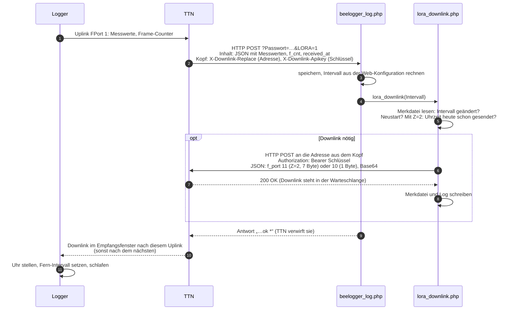

# Server: was mit einer Meldung auf dem beelogger-Server passiert

[← Übersicht](README.md)

Stand: 10.11.2026 · gilt für: Server-Skripte M.40 (Paket M40_261109), `server/lora_downlink.php` vom 09.11.2026 ·
geprüft gegen Code: `server/M40_261109/beelogger1/beelogger_log.php`, Commit 7ccdb38; CSV, Zahlenformate,
Kompensation, Installation: Commit a688002 ·
`lora_downlink.php`: Branch `p7-serverquittung`, noch nicht in `main`

Die Server-Skripte stammen von beelogger.de (GPLv3). Eine unveränderte Kopie des Pakets M40_261109 liegt unter
[`server/M40_261109/`](../server/M40_261109/). Zeilennummern beziehen sich auf deren `beelogger1/beelogger_log.php`. Überblick über den Datenweg: [architektur.md](architektur.md).

## Ordner und Dateien

Jeder Logger hat auf dem Server einen eigenen Ordner. Der **Name** bestimmt, wie viele Waagen erwartet werden:

| Ordner beginnt mit | Waagen |
|---|---|
| `beelogger` | 1 |
| `Duo` | 2 |
| `Triple` | 3 |
| `Quad` | 4 |
| `Penta` | 5 |
| `Hexa` | 6 |

Wichtige Dateien im Ordner:

| Datei | Zweck |
|---|---|
| `beelogger_log.php` | nimmt Meldungen an (WLAN/LTE per GET, LoRa per Webhook-POST) |
| `beelogger_ini.php` | Einstellungen dieses Loggers, geschrieben von der Web-Konfiguration |
| `beelogger_show.php` | Anzeige (Diagramme) |
| `beelogger.csv`, `month.csv`, `week.csv` | Messdaten: alles, letzter Monat, letzte Woche |

**Installation (Original-Skripte).** Laut beelogger.de: PHP 8, für einige Funktionen cURL. Ein Basisordner mit
Schreibrecht enthält `general_ini.php` (Sprache, Tageswächter, Schlüssel für Wetter/Karte), `beelogger_cron21.php`,
`Errorchecker*.php`, `beelogger_mobileWatch.php`, `beelogger_mobileCheck.php`, Dygraph-Dateien, Icons und Sprachen,
darunter je Logger ein Ordner. Fehlende Dateien (`beelogger_ini.php`, CSV-Dateien, `notes.csv`, `Schwarminfo.php` …)
legen die Skripte selbst an. Fehlerprotokolle von `beelogger_log.php` (falsches Passwort, fehlerhafte Daten)
landen in `ErrorcheckerData.php` im Basisordner. `local_Updater.php` kopiert neue Skripte in bestehende Ordner:
ohne Option nur Anzeige, `?U` Skripte, `?X` Icons und Sprachen. Weitere Logger-Ordner legt die Web-Konfiguration
an; die Ordnernamen nicht von Hand ändern.

**Oberfläche.** `beelogger_show.php` zeichnet mit Dygraph bis zu 26 Datenreihen (CSV-Spalten 2–27) aus
`week.csv`, `month.csv` oder `beelogger.csv`, mit Anmerkungen aus `notes.csv`. Zugang zur Konfiguration mit dem
Show-Passwort (`$BeeloggerShowPasswort`), die Annahme mit dem Log-Passwort (`$BeeloggerLogPasswort`). Im Paket
M40_261109 fehlt `beelogger_show.php` (Packfehler); vorhanden ist die schlanke Variante `beelogger_sml.php`.
Das beelogger-Team liefert `beelogger_show.php` mit dem nächsten Paket M41 nach (Auskunft 10.11.2026).

## Ablauf bei einer LoRa-Meldung

1. TTN ruft `beelogger_log.php?Passwort=<LogPasswort>&LORA=1` per POST auf, mit dem Uplink als JSON.
2. Passwort prüfen (`$BeeloggerLogPasswort` aus `beelogger_ini.php`).
3. Werte aus `decoded_payload` übernehmen. Jedes Feld muss auf `^[0-9\-\.]+$` passen, sonst bleibt es leer.
   Der RSSI des ersten Gateways landet in `Aux2`. Felder der Waagen 2 ff. (`Gewicht2`, `TempIn2` …) liest der
   Server nur, wenn der Ordnername so viele Waagen erwartet. Mehr gesendete Waagen fallen weg. `Aux3` wird als
   Sketch-ID `LORA_<Aux3>` gemerkt. Fehlt das Feld (9 von 10 Uplinks), bleibt die zuletzt gemerkte ID.
4. **Zeitstempel = Serverzeit** (Europe/Berlin), Sekunden auf 00 gesetzt. Die Uhr im Logger spielt dafür
   keine Rolle.
5. [Temperaturkompensation](#temperaturkompensation-der-waagen) der Waagen (Korrekturwert je °C, in der Web-Konfiguration).
6. **Speicherregel** prüfen (nächster Abschnitt), dann in die CSV-Dateien schreiben.
7. Schwarmalarm, Trigger-Alarme, Weitergabe (z. B. BEEP, ThingSpeak) nach Einstellung, siehe
   [server_alarme.md](server_alarme.md).
8. Antwort an den Aufrufer: `<Zeit>T<Intervall>B<Service>ok *`. Ein WLAN-Logger liest daraus Uhrzeit und
   Intervall. **Bei LoRa verwirft TTN diese Antwort**, dafür gibt es `lora_downlink.php` (unten).

## Speicherregel: Mindestabstand

`beelogger_log.php`, ab Zeile 573: Eine Meldung wird nur gespeichert, wenn ihr Zeitstempel weit genug hinter
der zuletzt gespeicherten liegt.

| Bedingung | Mindestabstand |
|---|---|
| normal | **mehr als 220 s**, auf community.beelogger.de Oktober bis Februar **mehr als 520 s** |
| Service-Wert negativ (z. B. RSSI) | mehr als 110 s |
| Service = 99 (Arbeitsschalter) | jede Meldung, die später als die letzte ist |
| Kalibriertemperatur = `99.9` (Einstellung) | mehr als 55 s |

**Community-Server:** Die 520 s gelten nur, wenn der Server `community.beelogger.de` heißt (Monat < 3 oder > 9).
Eigene Server bleiben bei 220 s. Folge: Ein Logger mit 5-min-Intervall verliert im
Winter auf dem Community-Server etwa jede zweite Meldung. Das ist so gewollt. Wer alle sehen möchte, sendet
im Winter alle 10 min (siehe [intervalle.md](intervalle.md)).

`99.9` als Kalibriertemperatur ist nur für Tests und die Kalibrierung gedacht, nicht für den Dauerbetrieb.

## Service-Wert

Der Logger schickt in jeder Meldung ein Byte `Service` (siehe [payload.md](payload.md)). Der Server wertet aus:

| Wert | Wirkung auf dem Server |
|---|---|
| 0 – 98 | normal (Wachzeit des Loggers in s) |
| 99 | sofort speichern, Durchsicht-Symbol setzen (höchstens alle 40 min), Schwarmalarm aus |
| über 240 | Durchsicht-Symbol wie bei 99 |
| über 1000 | wird zu 99 |
| −1 | wird leer gespeichert |
| andere negative | gelten als RSSI |

Der **Schwarmalarm** prüft nur, wenn Service in der aktuellen **und** in der zuletzt gespeicherten Meldung
unter 99 liegt. So löst eine Durchsicht am Volk (Arbeitsschalter, Gewicht ändert sich) keinen Alarm aus.

## Was gespeichert wird: CSV-Dateien

Wird gespeichert, hängt der Server dieselbe Zeile an `beelogger.csv`, `month.csv` und `week.csv` an
(Zeilenende `\r\n`, Zeilen 630–675). Bei Multi-Loggern bekommt zusätzlich jede Waage eine Zeile im Format des
Einzel-Loggers im Unterordner `beelogger<Kennbuchstabe><Nr>_<Waage>` (z. B. `beeloggerQ4_1` … `beeloggerQ4_4`,
Kennbuchstabe D/T/Q/P/H).

**Kürzen** (`CSVbuilder_log()`, Zeile 1188): nach dem Speichern, wenn die Stunde kleiner als 8 ist und
`month.csv` mehr als 20 Zeilen hat. `month.csv` behält die letzten 31 Tage (2 678 400 s vor dem jüngsten
Zeitstempel), `week.csv` die letzten 7 Tage (604 800 s). `beelogger.csv` wird nie gekürzt.

**Multi-Logger** (Ordner im Beispiel Quad, *n* = 4 Waagen, 30 Spalten):

| Spalte (Quad) | Inhalt |
|---|---|
| 1 | Zeit `YYYY/MM/DD HH:MM:00` (Europe/Berlin) |
| 2 | Wägezellentemperatur (= `TempOut`) |
| 3 | Außentemperatur |
| 4 | Luftfeuchte außen |
| 5 | Service |
| 6 | Licht |
| 7–10 | Gewicht 1…*n*, temperaturkompensiert |
| 11–14 | Temperatur Beute 1…*n* |
| 15–18 | Luftfeuchte Beute 1…*n* |
| 19, 20 | Akku `VBatt`, Solar `VSolar` |
| 21–24 | Gewicht 1…*n*, roh |
| 25, 26, 27 | `Aux1` (Luftdruck), `Aux2` (RSSI), `Aux3` (Sketch-ID) |
| 28, 29 | leer |
| 30 | Unix-Zeitstempel |

Bei Duo, Triple, Penta, Hexa ändert sich nur *n*.

**Einzel-Logger und Unterordner** (17 Spalten): Zeit, Temperatur Beute, Temperatur außen, Feuchte Beute,
Feuchte außen, Licht, Gewicht kompensiert, VBatt, VSolar, Service, Gewicht roh, Aux1, Aux2, Aux3, leer, leer,
Zeitstempel. Fehlt `VBatt` (Bienenzähler), stehen in Spalte 8 und 9 `BienenIn` und `BienenOut`.

Bei WLAN/LTE-Loggern bedeuten `Aux1`–`Aux3` Luftdruck, Regen, Systemtemperatur; bei LoRa Luftdruck, RSSI,
Sketch-ID.

## Zahlenformate

Vor dem Speichern (Zeilen 583–605). `number_format` rundet kaufmännisch (0,5 aufwärts).

| Wert | Nachkommastellen | Beispiel |
|---|---|---|
| Wägezellentemperatur | 2 | 19,56 → `19.56` |
| Außen- und Beutentemperatur, Feuchten, Licht | 1 | 19,56 → `19.6` |
| VBatt, VSolar | 2 | 4,078 → `4.08` |
| Aux1 (Luftdruck) | 1, vorher `+ $KorrPressure` | 1013,2 → `1013.2` |
| Aux2, Aux3 | 1 | −74 → `-74.0` |
| Gewicht roh | 3 unter 14,5 (auch negativ), sonst 2 | −65,52 → `-65.520`; 44,44 → `44.44` |
| Service | −1 → leer, über 1000 → 99, sonst auf 1 Stelle gerundet | |

## Temperaturkompensation der Waagen

Zeilen 608–628. Je Waage *k* mit Korrekturwert `$KorrekturwertArray[k]` und `$KalibrierTemperatur` aus der
Web-Konfiguration. Als Temperatur dient die Wägezellentemperatur, bei LoRa also `TempOut`.

```
Δ = (Temperatur − KalibrierTemperatur) × Korrekturwert[k]
|Korrekturwert| < 2  (kg/°C):  Gewicht = round(Gewicht_roh + Δ, 3 Stellen unter 10 kg, sonst 2)
sonst                (g/°C):   Gewicht = round(Gewicht_roh + Δ)
```

Ist der Korrekturwert 0 oder leer, die Kalibriertemperatur leer oder kein Gewicht da, bleibt das Rohgewicht.

**Korrekturwert bestimmen** (Verfahren von beelogger.de): Waage mit festem Gewicht belasten, Korrekturwert 0,
über mehrere Tage mit deutlichen Temperaturschwankungen aufzeichnen. Weil der Server Gewichte kompensiert
**und** roh speichert, reicht die Rohreihe. Aus einem Abschnitt mit großem Temperaturhub:

```
Korrekturwert [kg/°C] = −1 × Gewichtsdifferenz / Temperaturdifferenz
Beispiel: −1 × (2,72 − 2,40) kg / (7 − 16) °C = 0,0355 kg/°C
```

Kalibriertemperatur = Temperatur, bei der die Waage das aufgelegte Gewicht genau anzeigt. Der Logger muss
dafür nicht neu geflasht werden.

## Sendeintervall vom Server: `ServerZeitSteuerung()`

Zeile 415. Der Server rechnet aus der Web-Konfiguration ein Intervall aus und schickt es WLAN-Loggern in der
Antwort. Mit `lora_downlink.php` erreicht es auch LoRa-Logger.

| Einstellung (`beelogger_ini.php`) | Wirkung |
|---|---|
| `$IntervallSendeSteuerung` = `zeitgesteuert` | Tag von `$SommerTagZeit` bis `$SommerNachtZeit` (ab 4 min vor der vollen Stunde) |
| … = `lichtgesteuert` | Tag, wenn Licht > 1 Lux. Ohne Lichtwert gilt zeitgesteuert. |
| … = `solarspannungsgesteuert` | Tag, wenn Solarspannung > 0,3 V. Ohne Wert gilt zeitgesteuert. |
| `$SommerSendeIntervallTag` / `…Nacht` | Intervall Tag / Nacht in Minuten |
| `$WinterBeginn`, `$SommerBeginn`, `$WinterSendeIntervall` | außerhalb Sommer: Winterintervall. `deaktiviert` = aus. |

Das Ergebnis ist höchstens 60 min. Ohne Einstellung gilt 15 min.

## Rückkanal für LoRa: `lora_downlink.php` (eigene Erweiterung)

[`server/lora_downlink.php`](../server/lora_downlink.php) schickt das Intervall aus `ServerZeitSteuerung()`
und die Empfangszeit als Downlink FPort 11 an den Logger. Der Logger stellt damit Uhr und Intervall wie ein
WLAN-Logger. Format: [payload.md](payload.md#downlink-fport-11-serverquittung-uhr--intervall).

Die Erweiterung ist ein Vorschlag und läuft **nicht** auf dem Community-Server, sondern nur dort, wo sie
jemand einbindet.

### Warum es diese Datei braucht

Ein WLAN-Logger ruft `beelogger_log.php` selbst auf und liest Uhrzeit und Intervall aus der Antwort. Einen
LoRa-Logger ruft der Server nie direkt: Der Aufruf kommt von TTN (Webhook), und **TTN verwirft die Antwort**.
Sie wird auch nicht an den Logger weitergereicht. `lora_downlink.php` umgeht das: Sie bestellt den Downlink
in einem **zweiten, eigenen Aufruf** bei TTN. Dafür schickt TTN bei jedem Webhook-Aufruf eine Adresse und
einen Schlüssel mit, unter denen man einen Downlink für genau dieses Gerät bestellen kann.

### Wer macht was wo

| Wo | Wer | Was |
|---|---|---|
| Bienenstand | Logger | misst, sendet Uplink FPort 1, öffnet 1 s und 2 s danach je ein kurzes Empfangsfenster, übernimmt Uhrzeit und Intervall aus einem Downlink |
| Funk | Gateway | leitet Uplink an TTN weiter, sendet Downlinks von TTN aus |
| TTN | Network Server | entschlüsselt, prüft Zähler, verwaltet die Downlink-Warteschlange je Gerät |
| TTN | Application Server | Payload-Formatter (Decoder), Webhook-Aufruf an den Server, nimmt Downlink-Bestellungen an |
| Server | `beelogger_log.php` | speichert Messwerte, rechnet das Intervall (`ServerZeitSteuerung()`), ruft am Ende `lora_downlink()` auf, antwortet an TTN (Antwort verfällt) |
| Server | `lora_downlink.php` | entscheidet, ob ein Downlink nötig ist, baut 1 Byte (FPort 10) oder mit `Z=2` 7 Byte (FPort 11), bestellt den Downlink bei TTN, schreibt Log und Merkdatei |

### Welche Information wohin geht



Inhalt der 7 Byte: [payload.md](payload.md#downlink-fport-11-serverquittung-uhr--intervall).

Kommt ein Downlink nicht an (z. B. kein Gateway in Reichweite), passiert nichts Schlimmes: Der Logger behält
das bisherige Intervall und seine Uhr, die Messwerte kommen trotzdem an, und der Server stempelt sie mit
seiner eigenen Zeit. Antwortet TTN nicht mit `200`, versucht es `lora_downlink.php` beim nächsten Uplink
erneut. Hat TTN den Downlink angenommen, der Logger ihn aber nicht empfangen, merkt der Server das nicht:
Die Uhrzeit kommt dann erst am nächsten Tag wieder, ein geändertes Intervall erst bei der nächsten Änderung.

### Einbinden

Ab Server-Skripten **M40_261109** ist alles enthalten: `beelogger_log.php` ruft `lora_downlink()` selbst auf
(Zeile 804), und `local_Updater.php` kopiert `lora_downlink.php` in jeden Logger-Ordner. Ältere Skripte:

1. `lora_downlink.php` in den Logger-Ordner kopieren (neben `beelogger_log.php`).
2. In `beelogger_log.php` in der Funktion `Auswertung()` direkt **vor** der Antwortzeile einfügen:
   ```php
   if(isset($_GET["LORA"]) && file_exists("lora_downlink.php")){include_once("lora_downlink.php");lora_downlink($MessIntervall);}
   ```
   `isset($_GET["LORA"])` ist dort nötig, weil `$LORA` in `Auswertung()` erst ab M40_261109 global ist.

Für beide gilt:

1. Im TTN-Webhook, der zu diesem Server führt, einen **Downlink API key** eintragen (Recht
   `traffic down write`, siehe [ttn_einrichten.md](ttn_einrichten.md)). Ohne Key schickt TTN keine
   Push-URL mit, und die Erweiterung schreibt nur einen Hinweis ins Log.
2. Soll der Logger auch die Uhrzeit bekommen: in der Webhook-Adresse `&Z=2` anhängen (siehe
   [Wann gesendet wird](#wann-gesendet-wird)).
3. **Mehrere Webhooks (mehrere Server):** Der Key gehört nur in **einen** Webhook. Nur dieser Server
   bekommt die Header `X-Downlink-Replace` und `X-Downlink-Apikey` und kann Downlinks senden; er bestimmt
   Intervall und Uhrzeit. Die übrigen Server bekommen nur die Daten, ihre Intervall-Einstellung wirkt nicht
   auf den Logger. Hätten zwei Webhooks einen Key, würden beide senden. Weil über die Replace-Adresse
   gesendet wird, ersetzt jeder Downlink den vorigen in der TTN-Warteschlange: Es staut sich nichts, aber
   es gilt der zuletzt gesendete, und welcher das ist, ist Zufall.

Fehlt die Datei, läuft `beelogger_log.php` unverändert weiter.

### Wann gesendet wird

Was gesendet wird, wählt man wie bei WLAN über die Webhook-Adresse:

| Webhook-Adresse | Downlink | Inhalt |
|---|---|---|
| mit `&Z=2` (z. B. `…beelogger_log.php?Passwort=…&LORA=1&Z=2`) | FPort 11, 7 Byte | Intervall und Uhrzeit |
| ohne `Z=2` | FPort 10, 1 Byte | nur Intervall |

Bei **jeder** LoRa-Meldung prüft die Funktion, ob ein Downlink nötig ist. Gesendet wird nur, wenn
- sich das Intervall gegenüber dem zuletzt gesendeten geändert hat,
- der Logger neu gestartet ist (Frame-Counter kleiner als beim letzten Uplink, z. B. nach Akku ab):
  Das Fern-Intervall übersteht keinen Stromausfall, also wird es neu geschickt, mit `Z=2` auch die Uhrzeit,
- nur mit `Z=2`: heute noch keine Uhrzeit gesendet wurde oder Sommer-/Winterzeit seit dem letzten Stellen
  gewechselt hat (`date("I")`).

Im Normalbetrieb ist das mit `Z=2` **ein Downlink pro Tag**, ohne `Z=2` nur einer bei jeder Änderung des
Intervalls (TTN Fair Use: etwa 10 pro Gerät und Tag). Nur Intervalle von 5–60 min werden übertragen; mit
`Z=2` steht sonst 0 (unverändert) im Byte, ohne `Z=2` wird dann nichts gesendet.

### Dateien, die die Erweiterung anlegt

| Datei | Inhalt |
|---|---|
| `lora_downlink_state.json` | letzter FCnt, Empfangszeit, gesendetes Intervall, Tag und Sommerzeit-Merker der letzten Uhrzeit, offener Neustart |
| `lora_downlink.log` | eine Zeile pro Downlink-Versuch mit HTTP-Antwort von TTN |

Beispielzeile im Log:

```
2026-11-08 15:50:03 FCnt 42 Downlink iv=10 t=2026-11-08 15:50:00 gap=10 -> HTTP/1.1 200 OK
```

Beide Zeiten sind Serverzeit (hier MEZ). `t` ist die Empfangszeit des Uplinks bei TTN. Ist die Antwort nicht `200`, wird beim nächsten Uplink erneut
gesendet.

### Sicherheit

Die Push-URL wird nur angenommen, wenn sie auf `*.cloud.thethings.network` zeigt. Der API-Key kommt bei
jedem Aufruf von TTN im Header mit und wird nicht gespeichert.
