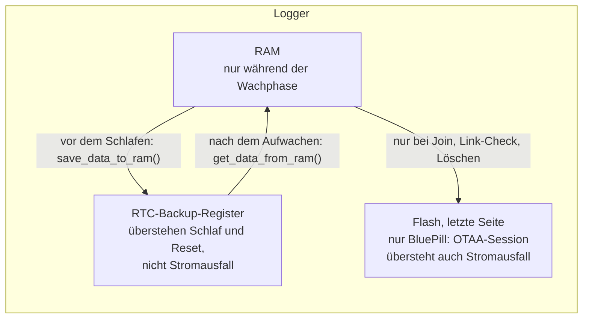

# Speicher: was sich der Logger merkt und wann es verloren geht

Stand: 09.11.2026 · gilt für: STM32 261107 · geprüft gegen Code: Commit 80673f1

Der STM32-Logger schläft zwischen zwei Messungen im **Shutdown** (Standby, `LowPower.shutdown()` in
`src/STM32_LORA_utility.ino`). Beim Aufwachen startet er wie nach einem Reset, das RAM ist dann leer.
Alles, was er sich über den Schlaf hinweg merken muss, liegt deshalb an zwei Stellen:

- in den **RTC-Backup-Registern** (laufen mit der Uhr weiter, solange Strom da ist),
- beim BluePill zusätzlich in **einer Flash-Seite** (übersteht auch einen Stromausfall).

## Wo was liegt

### Belegung der Backup-Register

| Register | BluePill (F103, 10 Register à 16 Bit) | BlackPill (F411/F401, 32 Bit) |
|---|---|---|
| 0 | von der RTC-Bibliothek belegt, im Sketch nicht benutzt | ebenso |
| 1, 2 | letztes Gewicht Waage 1, 2 (× 100) | frei |
| 3 | LoRa-Frame-Counter (`LoRaSeqCounter`) | ebenso |
| 4 | Weckintervall (Bit 0–7), Einschaltdauer `time_on` (Bit 8–15) | ebenso |
| 5 | `stuck_switch` (Bit 0–4), `akku_save` (Bit 8), Fern-Intervall ÷ 5 (Bit 9–14) | ebenso |
| 6, 7 | Datum der RTC (die F1-Uhr kennt selbst nur Sekunden, die Bibliothek legt das Datum hier ab) | letztes Gewicht Waage 1, 2 |
| 8, 9 | letztes Gewicht Waage 3, 4 | ebenso |
| 10 | Watchdog-Merker | OTAA-Session, Teil 1 |
| 11–13 | – (gibt es beim F103 nicht) | OTAA-Session, Teil 2–4 |
| 14 | – | Watchdog-Merker |

Quelle: `save_data_to_ram()` / `get_data_from_ram()` in `src/STM32_LORA_utility.ino`, Watchdog `WDT_REG`
ebenda, OTAA-Session `otaa_rd()`/`otaa_wr()` in `src/STM32_LORA.ino`.

Die Register 1–9 sind die gewachsene Belegung des LoRa-Sketches (Original 260705). Neu (261107) sind nur
Bit 9–14 in Register 5 und die Register ab 10. Die WLAN/LTE-Sketche belegen die Register anders. Eine
Angleichung wurde erwogen und am 09.11.2026 bewusst verschoben (siehe unten, „Update mit anderer Belegung“).

### OTAA-Session

Nach einem Join merkt sich der Logger DevAddr, NetID, AppNonce, DevNonce, Rx1-Delay und Rx2-Datenrate,
dazu eine Versionsnummer und eine Prüfsumme: zusammen 4 × 32 Bit = 16 Byte. Die Sitzungsschlüssel speichert
er nicht, er rechnet sie nach jedem Aufwachen aus dem AppKey neu aus.

- **BlackPill:** in den Backup-Registern 10–13.
- **BluePill:** Die 10 Register sind schon belegt und haben nur 16 Bit. Deshalb liegt die Session in der
  **letzten Flash-Seite** (1 KB). Die Adresse rechnet der Sketch aus der Flash-Größe des Chips aus
  (F103CB: 128 KB, Seite bei 0x0801FC00), siehe `otaa_flash()`.

## Flash beim BluePill

- **Wann geschrieben wird:** nur bei einer Änderung: nach einem Join, einmal am Tag nach dem Link-Check und
  beim Löschen der Session. Das sind etwa 365 Schreibvorgänge im Jahr.
- **Haltbarkeit:** Eine Flash-Seite verträgt laut Datenblatt mindestens 10 000 Löschzyklen. Bei 365 im Jahr
  reicht das für gut 27 Jahre.
- **Schutz des Programms:** Vor dem Schreiben prüft der Sketch, ob die Seite hinter dem Programmende liegt.
  Liegt sie im Programm (kleiner Chip, große Firmware), speichert er nichts. Der Logger meldet dann
  `OTAA: kein Flash frei fuer Session, Join bei jedem Start` und joint bei jedem Aufwachen neu, statt sein
  eigenes Programm zu löschen.
- **Warum nicht im RAM:** Im Shutdown ist das RAM aus. Das RAM zu behalten ginge nur mit einem anderen
  Schlafmodus (Stop/deepSleep), der laut beelogger-Team beim F103 kaum mehr Strom braucht. Das wäre ein
  Umbau des Schlafablaufs und ist nicht geplant.

**Fehler bis 07.11.2026:** Die Seite lag zuerst fest bei 63 KB. Die Firmware mit BME280 und Lichtsensor ist
etwa 64 KB groß. Beim ersten Join schrieb der Logger seine Session mitten ins eigene Programm und löschte
dabei ein Stück davon. Das war kein Stack- oder Compilerproblem, sondern die feste Adresse. Seit 07.11.2026
wird die Seite aus der Chipgröße berechnet und gegen das Programmende geprüft.

## Was nach welchem Ereignis übrig bleibt

| Ereignis | Backup-Register | Flash-Seite (BluePill) | Folge |
|---|---|---|---|
| Tiefschlaf (normaler Zyklus) | bleiben | bleibt | Logger macht weiter, kein Join |
| Reset, Watchdog-Neustart | bleiben | bleibt | wie Tiefschlaf |
| **Stromausfall** (Akku ab, Strom-Jumper gezogen) | **gelöscht** | bleibt | Uhr auf 01.01.2022, Zähler 0, Gewichte leer, Fern-Intervall weg. Bei OTAA löscht der Sketch auch die gespeicherte Session und joint neu |
| Flashen ohne Löschen (Strom bleibt an) | bleiben | bleibt | neue Firmware liest die alten Werte |
| Flashen mit Löschen (`stm32loader -e`) | bleiben | **gelöscht** | BluePill: neuer Join; BlackPill: Session bleibt |

### Wie der Logger falsche Werte erkennt

Backup-Register können beim Start Werte enthalten, die nicht von dieser Firmware stammen: bei einem neuen
Chip (nicht sicher 0), bei einem Chip aus einem anderen Logger, nach einem versehentlich falschen Sketch.
Die Firmware prüft deshalb:

- **Jahr der Uhr:** Liegt es nicht zwischen 2022 und 2033, behandelt der Logger den Start wie nach einem
  Stromausfall: Uhr auf 01.01.2022, Register nicht übernehmen, OTAA-Session löschen.
- **OTAA-Session:** wird nur benutzt, wenn DevAddr ≠ 0, Versionsnummer und Prüfsumme stimmen. Sonst Join.
- **Watchdog-Merker:** zählt nur, wenn das obere Byte 0xA5 ist. Der Merker wird nach dem Lesen gelöscht.

Die übrigen Werte (Zähler, Intervall, Gewichte) haben keine eigene Prüfsumme. Stimmt das Jahr zufällig,
übernimmt der Logger sie.

### Update mit anderer Belegung

Würde eine neue Firmware die Register anders belegen, läse sie beim ersten Start alte Werte an falscher
Stelle. Abhilfe ist einfach und vom beelogger-Team so empfohlen: **nach dem Update einmal den Strom
trennen** (Akku ab oder Jumper ziehen). Dann startet der Logger wie neu: Zähler 0 (bei ABP muss in TTN
„Resets frame counters“ an sein, siehe [ttn_einrichten.md](ttn_einrichten.md)), OTAA joint neu. Bei den
WLAN/LTE-Sketchen gab es nach einer solchen Umstellung Anlaufschwierigkeiten, die sich nach einigen
Stunden von selbst gelegt haben (Rückmeldung beelogger-Team, 09.11.2026).

## Weiterlesen

- [abp_otaa.md](abp_otaa.md): Join, Neu-Join, Session
- [intervalle.md](intervalle.md): Fern-Intervall in Register 5
- [architektur.md](architektur.md#uhr-wann-sie-stimmt-und-wann-nicht): was ohne gestellte Uhr passiert
