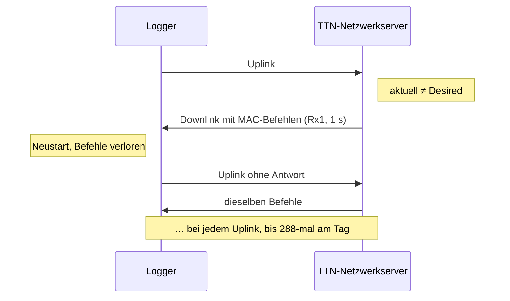

# TTN-Downlink-Schleife: Ursache und Behebung

[← Übersicht](README.md)

Stand: 10.11.2026 · gilt für: Original-Firmware 230711/260705 (ABP) und STM32 261107 (ABP/OTAA) ·
geprüft gegen Code: Commit a688002 · Messungen: The Things Stack Sandbox eu1, v3.37.0, 23.10.–07.11.2026

Hintergrund zu [ttn_einrichten.md, Abschnitt 7](ttn_einrichten.md#7-mac-einstellungen-im-detail-abp-lmic-dieser-firmware).
Wer nur einen Logger richtig anlegen will, braucht diese Seite nicht.

## Zusammenfassung

- **Problem:** TTN schickte nach fast jedem Uplink denselben Satz MAC-Befehle als Downlink, bis zu 288 am Tag.
  Die Fair Use Policy erlaubt höchstens 10 Downlinks pro Tag und Gerät.
- **Ursache:** Die „Desired“-MAC-Werte des Geräts in TTN wichen vom tatsächlichen Zustand des Loggers ab.
  Der Logger startet nach jedem Zyklus neu und beantwortet MAC-Befehle nie, TTN wiederholt sie deshalb endlos.
- **Lösung:** In TTN die Desired-Werte an den Logger angleichen, ADR und Status-Abfrage abschalten, alle acht
  Kanäle als *Factory preset frequencies* eintragen, dann *Reset session and MAC state*.
- **Wirkung:** Nach dem Reset kein Downlink mehr (beelogger08: 67 Uplinks in 335 min ohne Downlink; nach einem
  späteren Zählerrücksprung 906 Uplinks ohne Downlink). Die Einstellungen gelten pro Gerät.
- Die erweiterte Firmware dieses Repos beantwortet MAC-Befehle ebenfalls nicht. Die TTN-Einstellungen bleiben
  nötig, mit zwei Abweichungen (Rx2 und Downlink-Zähler, siehe [unten](#erweiterte-firmware-was-anders-ist)).

## Mechanismus

Bei ABP führt der Netzwerkserver (NS) zwei Zustände: den **aktuellen** MAC-Zustand (was er vom Gerät annimmt)
und den **Desired**-Zustand (was er erreichen will). Weichen sie ab, schickt er MAC-Befehle. Erst wenn das Gerät
sie im nächsten Uplink (FOpts) beantwortet, gilt der neue Zustand als aktuell.

Der Logger geht nach jedem Zyklus in `LowPower.shutdown()`. Beim Aufwachen baut die LMIC ihren Zustand mit
`LMIC_reset()` neu auf; empfangene MAC-Befehle werden nie quittiert.

## Welche Einstellung welchen Befehl auslöst

Ein Downlink von beeloggerblue01 wurde mit dem NwkSKey entschlüsselt: FPort 0, MIC korrekt, FRMPayload 38 Byte
(5 × 6 + 5 + 2 + 1). Ein zweiter Downlink fünf Minuten später trug denselben Klartext.

| Einstellung in TTN (vorher) | Abweichung | Befehl im Downlink |
|---|---|---|
| Factory preset frequencies leer, Frequenzplan mit 8 Kanälen | 5 Kanäle (867,1–867,9 MHz) gelten als unbekannt | 5 × NewChannelReq |
| ADR = Dynamic mode | NS will Datenrate und Sendeleistung steuern | LinkADRReq (DR 0, TXPower 0, ChMask 0x00FF) |
| Desired Rx1 delay 5 s, Rx1 delay 1 s | 5 s ≠ 1 s | RXTimingSetupReq (5 s) |
| Status count / time periodicity 200 / 86400 | NS fragt regelmäßig den Gerätestatus ab | DevStatusReq |
| Desired Rx2 data rate index 3, Rx2 data rate index 0 | 3 ≠ 0 | **keiner** (kein RXParamSetupReq im Klartext) |

Die alte beelogger.de-Anleitung „Konfiguration Lora TTN“ zeigt Desired Rx1 delay 5, nur einen Factory-Preset-Eintrag
(`868300000`) und ADR/Status auf Vorgabe. Jedes danach angelegte Gerät hatte deshalb dieselbe Schleife.

## Die Einstellungen

Ort in der Konsole (v3.37): *End devices → Gerät → General settings → Network layer → Custom MAC settings*
(ältere Anleitungen: *Advanced MAC settings*).

| Feld | Wert | verhindert |
|---|---|---|
| Desired Rx1 delay | gleich Rx1 delay (1 s) | RXTimingSetupReq |
| Rx2 data rate index / Desired | gleich, passend zur Firmware: Original **0 / 0**, erweiterte Firmware **3 / 3** | Rx2-Fehlempfang |
| Factory preset frequencies | `868100000, 868300000, 868500000, 867100000, 867300000, 867500000, 867700000, 867900000` in dieser Reihenfolge | NewChannelReq |
| Status count / time periodicity | 0 / 0 | DevStatusReq |
| Adaptive data rate (ADR) | Disabled | LinkADRReq |

Unverändert bleiben Rx1 data rate offset 0, Rx2 frequency 869,525 MHz, Frame counter width 32 bit,
*Resets frame counters* an, Keys und Device address.

**Acht Kanäle, obwohl der Logger nur drei nutzt.** Mit `LORA_CHANNELS 3` sendet der Logger nur auf 868,1 / 868,3 /
868,5 MHz (`setup_LORA()` in `STM32_LORA.ino`). Mit allen acht Einträgen gilt die Kanalliste in TTN als
abgeglichen. Am Logger ändert das nichts. Getestet mit 3 Kanälen; 1 und 8 Kanäle nach derselben Überlegung, nicht
getestet.

**ADR.** `LMIC_reset()` schaltet ADR in der Bibliothek ein, daher `"adr": true` in den Uplinks der Original-Firmware.
Die erweiterte Firmware schaltet es mit `LMIC_setAdrMode(0)` ab. In TTN muss ADR trotzdem auf *Disabled*.

**Status-Abfrage.** Die Akkuspannung steht ohnehin in der Nutzlast.

**Reset session and MAC state.** Bei ABP bleiben Session-Keys, DevAddr und Downlink-Queue erhalten, nur der
MAC-Zustand wird zurückgesetzt. Bei OTAA wird die Session gelöscht: Der Logger braucht einen neuen Join, am
schnellsten durch kurzes Abklemmen des Akkus, sonst nach drei Tagen ohne Link-Check-Antwort
([lorawan.md](lorawan.md#otaa-und-link-check)).

## Ablauf pro Gerät

1. **Uplink-Zähler ansehen** (`f_cnt` in Live data), siehe [Frame-Counter-Lücke](#frame-counter-lücke-nach-der-umstellung).
2. Custom MAC settings öffnen, Werte aus der Tabelle oben setzen, **Save changes**.
3. Seite neu laden und prüfen, ob alle Werte erhalten sind. Am häufigsten fehlt etwas in der Factory-Preset-Liste.
4. **Reset session and MAC state** auslösen und bestätigen.
5. Zwei bis drei Uplinks abwarten und in Live data **des Geräts** (nicht des Gateways) prüfen: Uplinks erscheinen
   (`ns.up.data.process`, `as.up.data.forward`), kein „Schedule data downlink“ mehr.

Mit der erweiterten Firmware prüft `scripts/ttn-status.sh <app> <device>` die Werte, offene MAC-Befehle und
beide Downlink-Zähler.

*MAC settings profiles* (Werte einmal anlegen, mehreren Geräten zuweisen) gehören zu einer Application. Hat jeder
Logger eine eigene Application, bringt ein Profil wenig. Nicht getestet.

## Kontrolle und Fehlersuche

- Live data → *Export* als JSON → nach `ns.down.data.schedule.attempt` suchen. Kein Treffer nach dem Reset =
  Schleife beendet. In der Kopfzeile des Geräts darf der Wert „down“ nicht mehr steigen.
- Kommt weiter ein Downlink: Ereignis öffnen. `frm_payload` mit FPort 0 = noch offene MAC-Befehle; die Länge zeigt,
  wie viele.
- Trägt der Downlink das ACK-Flag in `f_ctrl`, sendet der Logger bestätigte Uplinks. Die Firmware dieses Repos
  sendet unbestätigt (`LMIC_setTxData2(1, payload, cnt, 0)`).
- **Keine Uplinks mehr nach der Umstellung**, obwohl das Gateway Pakete zeigt: In Live data des End devices nach
  `ns.up.data.drop` suchen. Steht dort nichts, ordnet TTN das Paket keinem Gerät zu (DevAddr oder MIC passt nicht).
  Häufigste Ursache: die Zählerlücke im nächsten Abschnitt.

## Frame-Counter-Lücke nach der Umstellung

Ein Anwender mit älteren Loggern (eigener Sketch ohne Zählerüberlauf, Zähler 62 980) hatte nach dem Reset keine
Uplinks mehr in TTN, obwohl sein Gateway sie empfing. Nach dem Zurücksetzen des Zählers im Logger (Sketch
`Set_LORA_Seq`) kamen die Daten wieder an, ohne Downlinks. Die Fehlermeldung in Live data wurde nicht
festgehalten; die Ursache ist sehr wahrscheinlich, aber nicht belegt.

Erklärung (LoRaWAN 1.0.x, nicht selbst getestet): Auf dem Funk stehen nur die unteren 16 Bit des Zählers
([lorawan.md](lorawan.md#frame-counter-16-bit-auf-dem-funk-32-bit-in-der-rechnung)). Für EU868 nennt die
Spezifikation eine größte Lücke (MAX_FCNT_GAP) von **16 384**. Nach dem Reset erwartet TTN einen kleinen Zähler,
die Lücke ist dann gleich dem Zähler des Loggers. beelogger08 lief mit 15 949–16 020 ohne Probleme, der Logger
mit 62 980 nicht.

| Firmware | Zähler | zu tun |
|---|---|---|
| 230711 | EEPROM, Überlauf nach 16382 (Original 230711) | nichts |
| 260705 und erweiterte Firmware, ABP | RTC-Backup-Register, Überlauf nach 16384 (`inc_LoRaSeq()`) | nichts; bei Bedarf Akku kurz ab → FCnt 0 |
| erweiterte Firmware, OTAA | Neu-Join ab FCnt 16000 (`OTAA_FCNT_MAX`) | nichts |
| ältere Sketches ohne Überlauf | läuft weiter | über ca. 16 000: im Logger auf 0 setzen oder Gerät neu anlegen |

Bei 288 Uplinks am Tag läuft der Zähler etwa alle 57 Tage über. Die Einstellungen oben überstehen das
(beelogger08: nach dem Rücksprung 906 Uplinks ohne Downlink).

## Erweiterte Firmware: was anders ist

| Punkt | Original (230711, 260705) | erweiterte Firmware (261107) |
|---|---|---|
| Downlinks | werden nicht ausgewertet | FPort 10 = Sendeintervall, FPort 11 = Serverquittung (nur Branch `p7-serverquittung`) |
| Rx2 data rate index / Desired | 0 / 0 (gleich sein genügt) | **3 / 3**, weil `LMIC.dn2Dr = DR_SF9`; mit 0 schickt TTN auf SF12, der Logger hört auf SF9 |
| ADR-Bit im Uplink | an (LMIC-Vorgabe) | aus (`LMIC_setAdrMode(0)`) |
| OTAA | – | Rx1-Delay und Rx2 kommen mit dem Join-Accept; in TTN trotzdem 1 s / DR 3 eintragen |
| Downlink-Zähler FCntDown | egal | muss **unter 65 536** liegen, im Network Server **und** im Application Server; der Reset setzt nur den ersten zurück ([ttn_einrichten.md, Abschnitt 7](ttn_einrichten.md#7-mac-einstellungen-im-detail-abp-lmic-dieser-firmware)) |

Geräte, die lange in der Schleife hingen, haben einen hohen FCntDown (beeloggerblue05: 224 647). Nach dem Flashen
der erweiterten Firmware kommt dann kein Downlink an, bis beide Zähler auf 0 stehen.

Feldgeräte mit Original-Firmware bleiben bei Rx2 0 / 0: ein Wechsel bräuchte einen weiteren Session-Reset und
bringt dort nichts (Entscheidung 07.11.2026).

## Offene Punkte

- Ob Custom MAC settings am Gerät ein zugewiesenes MAC settings profile überschreiben: nicht getestet.
- Ob *Reset session and MAC state* den Uplink-Zähler im NS auf 0 setzt: steht nicht in der TTS-Dokumentation.
- OTAA: Der Join-Accept kann eine Kanalliste (CFList) enthalten. Ob die Firmware sie nutzt oder beim nächsten
  Aufwachen wieder nur ihre eigenen Kanäle setzt (`LMIC_setupChannel`, `LORA_CHANNELS`): nicht geprüft.
- Welche der fünf Änderungen den Ausschlag gab, lässt sich aus den Logs nicht trennen. Weil jeder Befehl genau
  einer Einstellung zugeordnet ist, ist die Wirkung trotzdem plausibel.

## Quellen

- Live-Data-Exporte beelogger08 (JSON, UTC), entschlüsselter Downlink beeloggerblue01, Tests an beelogger08,
  beelogger09, beeloggerblue05, beelogger011 (23.10.–07.11.2026)
- TTN-Forum: „The Things Network Fair Use Policy“, „Fair Use Policy explained“, „How much frame count deviation is
  allowed?“
- The Things Stack Dokumentation „MAC Settings“ (Session and MAC State Reset, Factory preset frequencies)
- Code: `setup_LORA()`, `inc_LoRaSeq()`, `OTAA_FCNT_MAX` in `src/STM32_LORA.ino`
