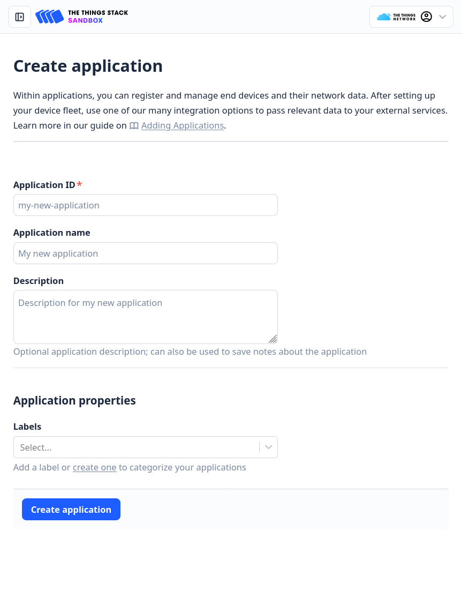
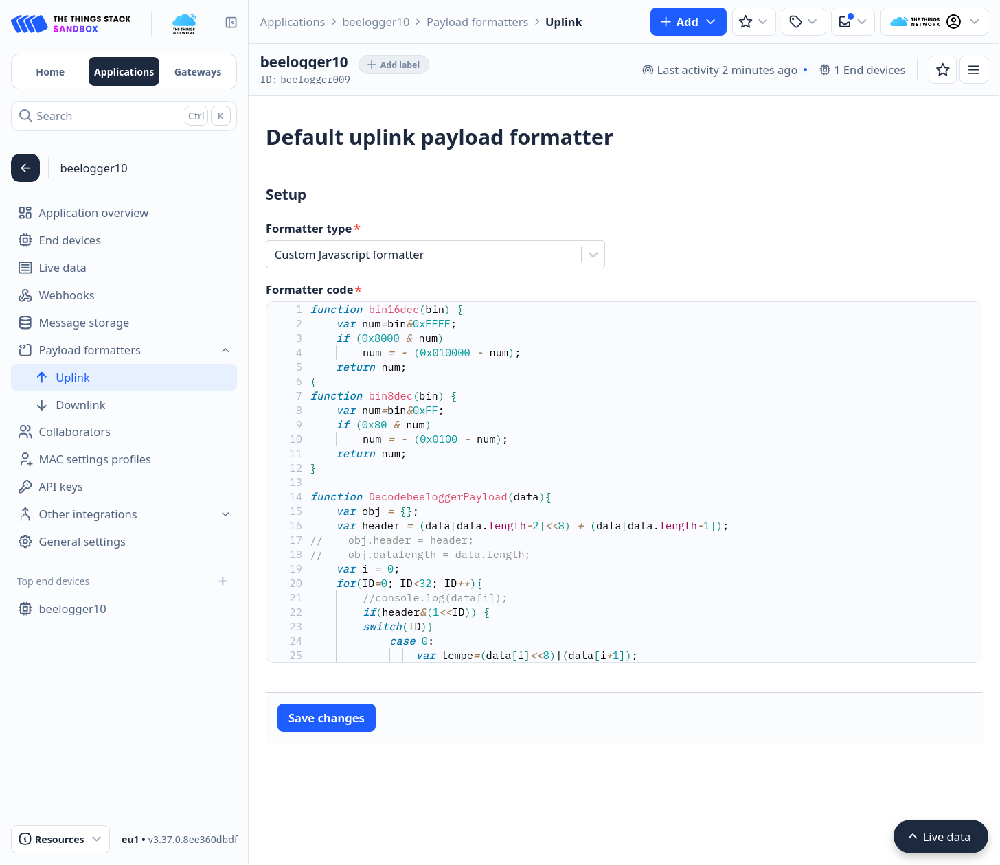
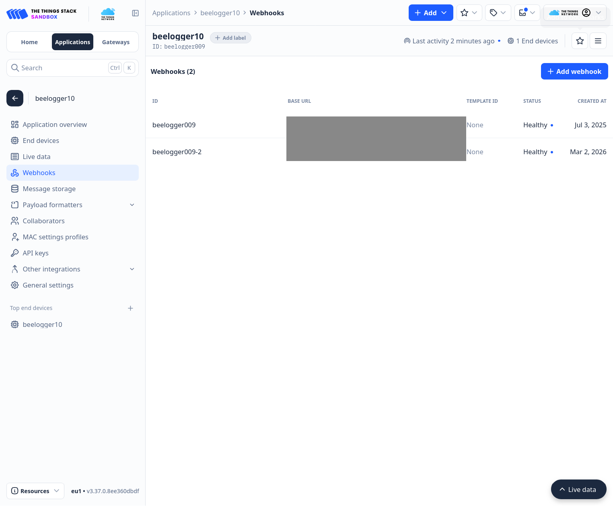
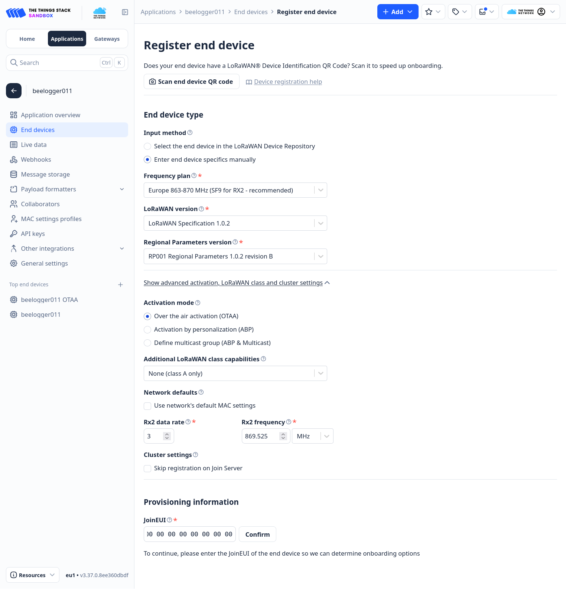
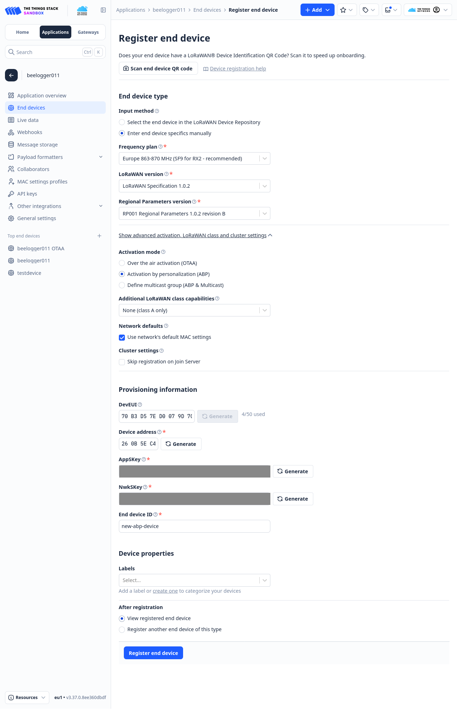
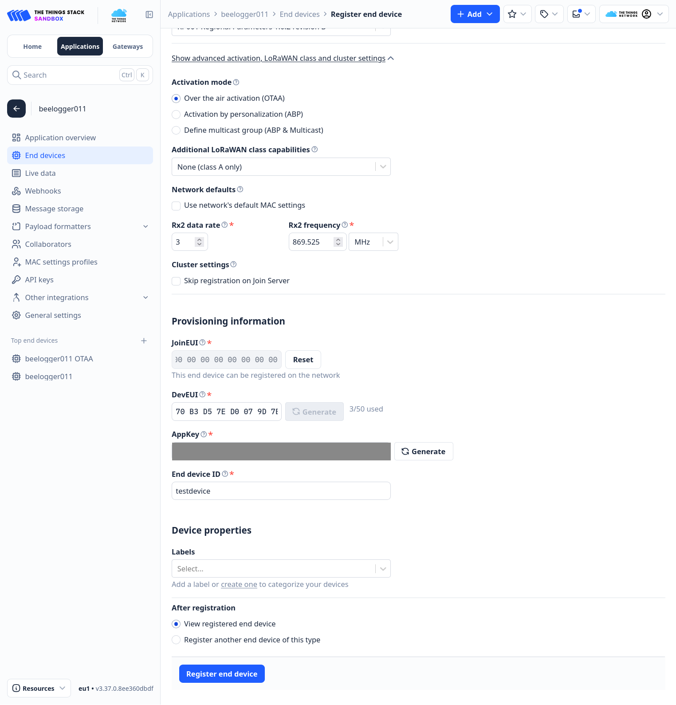
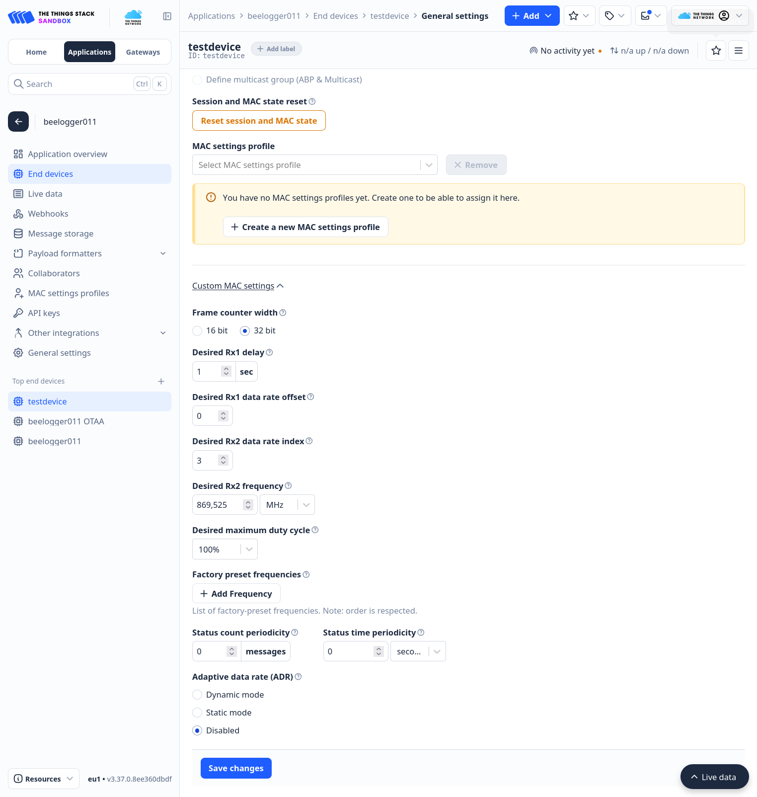
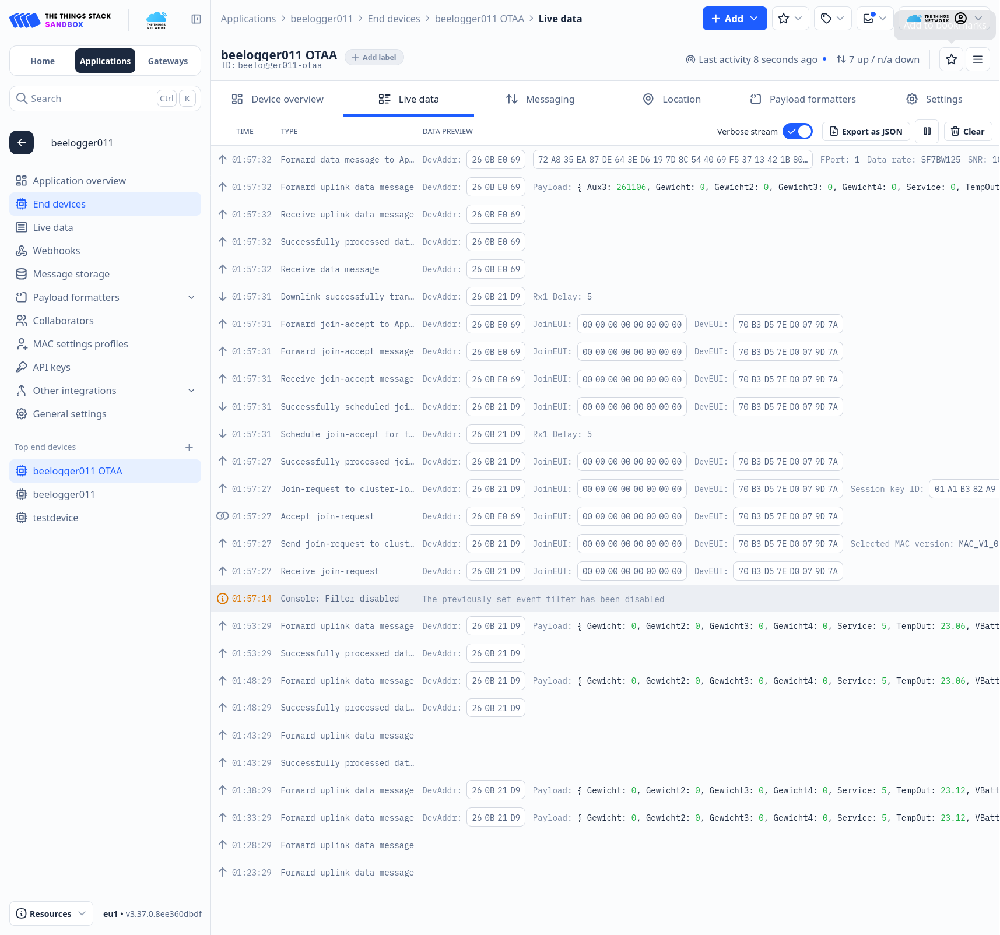
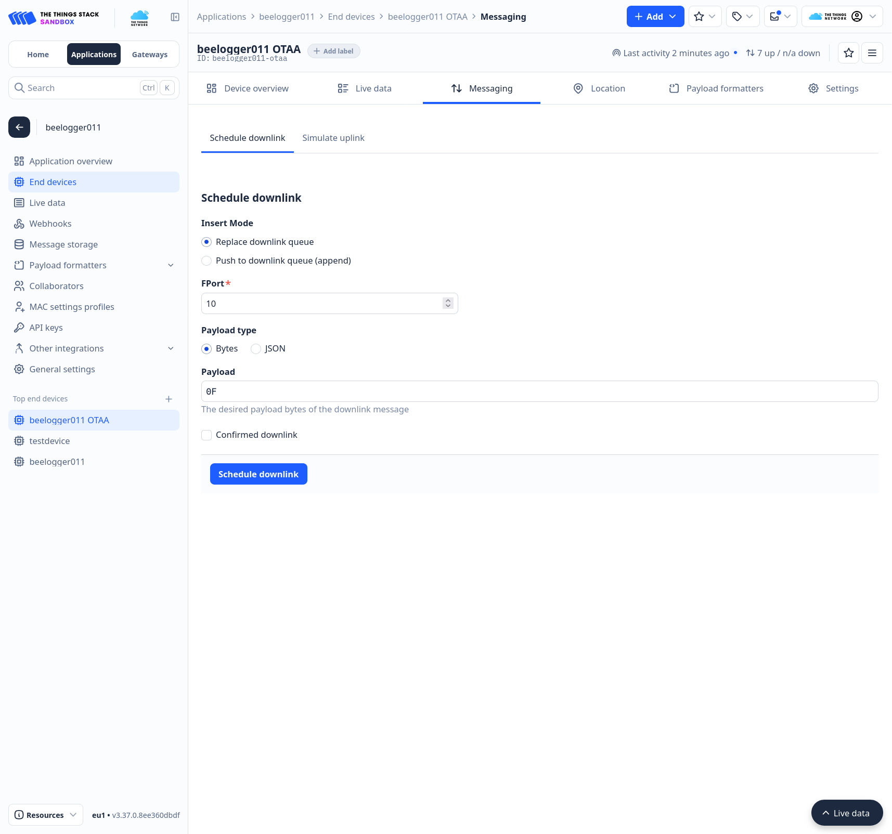

# TTN einrichten: beelogger in The Things Network anlegen

Stand: 08.11.2026 · gilt für: STM32 261107 (LMIC 1.5), ABP und OTAA · Abschnitt 1.4 und 4b (FPort 11):
Branch `p7-serverquittung`, noch nicht in `main`

Für diese Firmware (Kennung 261107, LMIC 1.5). Gilt für alle vier Varianten (BluePill F103, BlackPill F411/F401, jeweils ABP oder OTAA). Welche Variante passt: [abp_otaa.md](abp_otaa.md).

Konsole: <https://eu1.cloud.thethings.network/console> (Cluster Europa).

> Bilder: Platzhalter `bilder/…` liegen in `docs/ttn/bilder/`. Bildschirmfotos vor dem Einchecken auf Schlüssel prüfen (AppKey, NwkSKey, AppSKey schwärzen).

## 1. Application anlegen (einmal)

1. **Applications → + Create application**, Application ID z. B. `beelogger09`.
   
2. **Payload formatters → Uplink**: Formatter type „Custom Javascript formatter“, Inhalt von [`ttn/payload_decoder_ttn.js`](ttn/payload_decoder_ttn.js) einfügen, speichern.
   
3. **Webhooks → + Add webhook → Custom webhook**: Adresse des beelogger-Servers wie bei beelogger.de beschrieben (`…/beelogger_log.php?Passwort=…&LORA=1`), „Uplink message“ an.
   
4. **Optional: zweiter Webhook zum eigenen Server.** Eine Application kann mehrere Webhooks haben; jeder
   bekommt jeden Uplink. So gehen die Daten z. B. an den Community-Server **und** an einen eigenen Server.
   Webhook-ID frei wählbar (z. B. `<app>-2`), Base URL des eigenen Servers, „Uplink message“ an.
   Soll der eigene Server Uhrzeit und Intervall zurückschicken (`lora_downlink.php`, siehe
   [server.md](server.md#rückkanal-für-lora-lora_downlinkphp-eigene-erweiterung)), zusätzlich:
   - **Application → API keys → + Add API key**, Recht nur **„Write downlink application traffic“**.
   - Den Key im Webhook unter **Downlink API key** eintragen. TTN schickt dann bei jedem Uplink die
     Header `X-Downlink-Apikey` und `X-Downlink-Push`/`X-Downlink-Replace` mit.
   - Den Key nur dort eintragen, nicht in Dateien auf dem Server oder im Repo.
   Die Webhook-URL enthält das Upload-Passwort. Nicht in Foren, Bildschirmfotos oder Repos zeigen.

## 2. Gerät anlegen

**End devices → + Register end device → Enter end device specifics manually**

| Feld | Wert |
|---|---|
| Frequency plan | Europe 863-870 MHz (SF9 for RX2 – recommended) = `EU_863_870_TTN` |
| LoRaWAN version | LoRaWAN Specification 1.0.2 |
| Regional Parameters version | RP001 Regional Parameters 1.0.2 **revision B** (nicht „1.0.2“ ohne Zusatz) |
| Activation mode (unter „Show advanced activation …“) | ABP oder OTAA, passend zu `#define LORA_OTAA` |
| Additional LoRaWAN class capabilities | None (class A only) |
| Network defaults: „Use network's default MAC settings“ | **aus** – sonst Rx1 delay 5 s und ADR an, passt nicht zur Firmware. Die MAC-Werte dann wie in 2a Schritt 3 eintragen |
| Cluster settings: „Skip registration on Join Server“ | aus |



### 2a. ABP (`#define LORA_OTAA 0`)

1. Device address, NwkSKey, AppSKey mit **Generate** erzeugen (DevEUI ist bei ABP egal). End device ID = Name des Loggers. Im Bild ist „Use network's default MAC settings“ noch an: abwählen, siehe Tabelle oben.
   
2. In `src/Config_LORA.h` eintragen, beide Schlüssel in **MSB**-Reihenfolge (Schalter `<>` in der Konsole, Format „C-style“):
   - `DEVADDR = 0x260B….` (Device address)
   - `NWKSKEY[16]`, `APPSKEY[16]`
3. **General settings → Network layer → Custom MAC settings** genau wie in der Tabelle in Abschnitt 7, dazu wie bei OTAA (2b Schritt 4) Status count/time periodicity 0. Wichtig: **Resets frame counters an**, **Rx2 data rate index 3**, **ADR Disabled**, Rx1 delay 1 s. Aktuelle und „Desired“-Werte gleich. **Altgeräte mit alter Firmware** (Feld-Logger, nicht neu geflasht): Rx2 data rate index **0 / 0** (SF12, LMIC-Vorgabe ohne `LMIC.dn2Dr = DR_SF9`), dann Reset session and MAC state. Entscheidend ist, dass Einstellung, Desired und laufende Session übereinstimmen; das Skript prüft das.
4. Wurden die MAC-Einstellungen bei einem laufenden Gerät geändert: **Reset session and MAC state** (siehe Abschnitt 5), sonst gelten die alten Werte weiter.

### 2b. OTAA (`#define LORA_OTAA 1`)

Von Hand:

1. Im selben Formular (Haken „Use network's default MAC settings“ aus): **Rx2 data rate 3**, Rx2 frequency 869.525 MHz.
2. JoinEUI `0000000000000000`, **Confirm**. Dann DevEUI und AppKey mit **Generate** erzeugen. End device ID z. B. `<name>-otaa`. **Register end device**.
   
3. In `src/Config_LORA.h` eintragen:
   - `DEVEUI[8]` und `APPEUI[8]` (= JoinEUI) in **LSB**-Reihenfolge
   - `APPKEY[16]` in **MSB**-Reihenfolge
   
   Falsche Reihenfolge ist der häufigste Fehler: Das Gerät sendet Join-Requests, TTN antwortet nicht.
4. Gerät → **General settings → Network layer → Custom MAC settings** (Bild unten), dann **Save changes**:
   - Frame counter width 32 bit
   - **Desired Rx1 delay 1 s**, Rx1 data rate offset 0, Rx2 data rate index 3, Rx2 869,525 MHz
   - **Status count periodicity 0 und Status time periodicity 0** (Vorgabe 200 / 86400: TTN fragt sonst per MAC-Befehl den Gerätestatus ab, die Firmware antwortet nicht, Downlink-Schleife)
   - **Adaptive data rate: Disabled** (Vorgabe ist „Dynamic mode“)

   
   
   „Resets frame counters“ ist egal (jeder Join setzt die Zähler zurück). TTN schickt Rx1 delay und Rx2 mit dem Join-Accept; ohne diese Änderung wären es 5 s Wartezeit statt 1 s, der Logger bliebe pro Zyklus länger wach.

Mit Skript (legt Gerät mit allen MAC-Einstellungen an und schreibt die drei Werte in die richtige Reihenfolge in `Config_LORA.h`, ohne Schlüssel auszugeben):

```
scripts/ttn-otaa-anlegen.py <app> <device_id> <LOGGER_NAME> src/Config_LORA.h
```

Braucht einen API-Key in `~/.config/ttn/konto.key` (siehe Abschnitt 6). Der Block mit `#define LOGGER_NAME "<LOGGER_NAME>"` muss in `Config_LORA.h` schon stehen.

## 3. Bauen, flashen, prüfen

Bauen und flashen: [`bauen_flashen.md`](bauen_flashen.md). Danach:

1. **Serielle Konsole** (9600 Baud): Startzeile mit Name und DevAddr. OTAA: nach dem ersten Start Join (einige Sekunden), danach steht die neue DevAddr in der Startzeile.

   Auszug beelogger011 (OTAA, F103), Akku ab und an, gekürzt (`…`). Zeit links = PC-Uhr (MEZ), die Zahl vor `Joining`/`TX done` = LMIC-Zeit seit dem Aufwachen in Ticks zu 16 µs (62 500 = 1 s):

   ```
   01:57:24 261106STM32F103CB                      ← Firmware-Kennung, Board
   01:57:24 Name: beelogger011 UID: … DevAddr: 00000000   ← noch keine Session
   01:57:24 POR                                    ← Power-On-Reset: Akku war ab
   01:57:24   LoRaSeq_Nr:0 Interval: 5min  DL: 0min …
   …                                               ← Messwerte (Akku, Solar, Temperatur, Waagen)
   01:57:25 payload length: 21                     ← erster Uplink nach dem Einschalten: 4 Byte Firmware-Kennung mehr
   01:57:25 LoRa-frame counter: 0
   01:57:25 OTAA: Join
   01:57:26 117922: Joining
   01:57:32 510786: Joined DevAddr: 638312553      ← dezimal = 0x260BE069
   01:57:34 645782: TX done!                       ← Uplink FCnt 0 gesendet, Rx-Fenster vorbei
   01:57:34  Weckzeit 01.01.2022 00:39:59          ← nächstes Aufwachen (RTC-Zeit, nicht gestellt)

   01:58:27 Name: beelogger011 UID: … DevAddr: 260BE069   ← Session aus dem Speicher, kein Join
   01:58:27 RST                                    ← normales Aufwachen
   …
   01:58:29 payload length: 17
   01:58:29 LoRa-frame counter: 1
   01:58:31 249694: TX done!                       ← ohne Join nach 4 s statt 10 s

   02:08:30 DL Port 10: 15                         ← Downlink 0F im Rx-Fenster empfangen
   02:08:30  Weckzeit 01.01.2022 01:04:59          ← jetzt 15 min statt 5 min
   02:08:30   LoRaSeq_Nr:4 Interval: 5min  DL: 15min …
   ```

   Ohne `Joined` nach 30 s: Schlüssel und Byte-Reihenfolge prüfen (Abschnitt 5). ABP: kein `OTAA: Join`, DevAddr steht von Anfang an in der Startzeile.
2. **TTN → Gerät → Live data**: OTAA zeigt „Accept join-request“, dann den ersten Uplink mit FCnt 0. ABP: Uplinks direkt. Live data zeigt nur die letzten Meldungen; den Join sieht man nur, wenn die Seite beim Einschalten des Loggers offen ist. Im Bild (von unten nach oben): Uplinks alle 5 min, Akku ab und an, „Receive join-request“, „Accept join-request“ mit neuer DevAddr, nach etwa 4 s der erste Uplink mit `Aux3: 261106` (Firmware-Kennung nach dem Einschalten).
   
   Beispiele, wie es aussehen muss: [`ttn/beispiele/`](ttn/beispiele/) (OTAA-Join: `2026-11-06_beelogger08_otaa_live_data_join.json`).
3. **Skript** prüft die wichtigen Werte (ohne Schlüssel):

   ```
   scripts/ttn-status.sh <app> <device_id>
   ```

   Alle Zeilen müssen mit `ok` beginnen. Beispiel OTAA:

   ```
   beelogger011-otaa MAC_V1_0_2 OTAA
   ok FCntDown 1 (muss < 65536 sein, sonst Session/MAC-Reset)
      Session seit 2026-11-07T00:57:32 letzter FCntUp 3
   ok Einstellung rx1_delay: 1 / desired 1 (soll 1)
   ok Einstellung rx2_data_rate_index: 3 / desired 3 (gleich der Firmware: neue FW 3)
   ok laufende Session RX2-DR: 3 / 3 (ungleich Einstellung: MAC-Reset)
   ok offene MAC-Befehle: keine
   ok ADR aus: True
   ok Status periodicity count/time: 0 / 0s (soll 0 / 0s)
      letzte Uplinks (UTC, FCnt): [('00:57:27', 'Join'), ('00:57:32', 0), ('00:58:29', 1), ('01:03:29', 2), ('01:08:29', 3)]
   ok AS-FCntDown 2 (muss < 65536 sein; sonst AS-Zähler zurücksetzen)
   ```

## 4. Sendeintervall per Downlink

**Gerät → Messaging → Downlink**: FPort **10**, Payload hex = Intervall in Minuten (`0F` = 15 min, `00` = Vorgabe aus der Firmware). Kommt beim nächsten Uplink an.



Fair Use Policy: höchstens 10 Downlinks am Tag (Abschnitt 8).

### Downlink aus der Server-Software (TTN-API)

Für beelogger-Server, die das Intervall selbst umstellen sollen. TTN reiht den Downlink ein und schickt ihn im Empfangsfenster nach dem nächsten Uplink; er wirkt also ab dem übernächsten Zyklus.

- API-Key: **Application → API keys**, Recht **„Write downlink application traffic“**, sonst nichts. Key nur auf dem Server ablegen.
- Endpunkt (Cluster `eu1`):
  - `POST https://eu1.cloud.thethings.network/api/v3/as/applications/<app>/devices/<dev>/down/push` hängt an die Warteschlange an,
  - `…/down/replace` ersetzt sie. Für das Intervall besser `replace`: Wird mehrmals umgestellt, kommt nur der letzte Wert an und kein Downlink-Stau.
- Body: FPort 10, `frm_payload` = 1 Byte **Base64**.

| Intervall | hex | Base64 |
|---|---|---|
| Firmware-Vorgabe | `00` | `AA==` |
| 5 min | `05` | `BQ==` |
| 15 min | `0F` | `Dw==` |
| 30 min | `1E` | `Hg==` |
| 60 min | `3C` | `PA==` |

Gültig sind 0 und 5–180, andere Werte verwirft die Firmware ohne Meldung.

curl:
```bash
curl -X POST "https://eu1.cloud.thethings.network/api/v3/as/applications/beelogger011/devices/beelogger011-otaa/down/replace" \
  -H "Authorization: Bearer $TTN_KEY" -H "Content-Type: application/json" \
  -d '{"downlinks":[{"f_port":10,"frm_payload":"Dw==","priority":"NORMAL"}]}'
```
Antwort bei Erfolg: `{}` (HTTP 200).

PHP:
```php
function beelogger_intervall($app, $dev, $minuten, $key) {
    if ($minuten != 0 && ($minuten < 5 || $minuten > 180)) return false;
    $url  = "https://eu1.cloud.thethings.network/api/v3/as/applications/$app/devices/$dev/down/replace";
    $body = json_encode(["downlinks" => [[
        "f_port" => 10,
        "frm_payload" => base64_encode(chr($minuten)),
        "priority" => "NORMAL",
    ]]]);
    $ch = curl_init($url);
    curl_setopt_array($ch, [
        CURLOPT_POST => true,
        CURLOPT_POSTFIELDS => $body,
        CURLOPT_HTTPHEADER => ["Authorization: Bearer $key", "Content-Type: application/json"],
        CURLOPT_RETURNTRANSFER => true,
    ]);
    curl_exec($ch);
    $ok = curl_getinfo($ch, CURLINFO_HTTP_CODE) == 200;
    curl_close($ch);
    return $ok;
}
```

Hinweise:
- Rückmeldung: Der Uplink meldet das aktive Intervall (noch) nicht. Prüfbar am Abstand der Uplinks oder im seriellen Log (`DL Port 10: 15`).
- Kommt der Downlink nie an: FCntDown prüfen (Abschnitt 5).
- `<app>` ist die TTN-Application-ID (bei uns = Gerätename, z. B. `beelogger011`), `<dev>` die Device-ID (z. B. `beelogger011-otaa`).

### 4b. Automatisch vom eigenen Server: Serverquittung FPort 11

Mit `lora_downlink.php` (Abschnitt 1.4) braucht es keinen Downlink von Hand: Der Server schickt
das Intervall aus seiner Web-Konfiguration und einmal am Tag die Uhrzeit (FPort 11, 7 Byte). Format:
[payload.md](payload.md#downlink-fport-11-serverquittung-uhr--intervall), Einbau: [server.md](server.md).
Ob es ankommt: im seriellen Monitor `DL Port 11: …` und `Uhr gestellt`, auf dem Server `lora_downlink.log`.

## 5. Wenn etwas nicht geht

| Zeichen | Ursache | Abhilfe |
|---|---|---|
| Unter jedem Uplink ein Downlink, den niemand geschickt hat („Downlink-Schleife“) | MAC-Einstellungen in TTN passen nicht zur Firmware, oder nach dem Ändern fehlt der Reset | `ttn-status.sh` zeigt „offene MAC-Befehle“; Custom MAC settings prüfen, dann **Reset session and MAC state** |
| Downlink geschickt, kommt nie an | FCntDown in TTN über 65535 | `ttn-status.sh`; beide Zähler zurücksetzen (siehe unten) |
| ABP: Uplinks nach Akkuwechsel verworfen | Resets frame counters aus | einschalten |
| ABP: nach „Reset session and MAC state“ empfängt das Gateway, die App bekommt nichts (Uplink-FCnt hoch, z. B. 62980) | Nach dem Reset erwartet TTN den Zähler bei 0. Liegt der Logger mehr als 16 384 darüber, verwirft TTN jeden Uplink. „Resets frame counters“ hilft nicht: Es erlaubt nur den Sprung zurück auf 0, keine Lücke nach vorn | Logger kurz stromlos machen (Akku ab), dann sendet er mit FCnt 0. Alternativ in TTN den erwarteten Zähler auf den Stand des Loggers setzen (API, `session.last_f_cnt_up`, ungeprüft). Gemeldet von einem Nutzer am 06.11.2026 |
| OTAA: Join-Requests ohne Antwort | DevEUI/JoinEUI nicht LSB oder AppKey nicht MSB | Reihenfolge prüfen, neu flashen |
| Geänderte Einstellung wirkt nicht (ABP) | laufende Session nutzt alte Werte | Reset session and MAC state |

**Reset session and MAC state** (setzt den FCntDown im Network Server auf 0):
- Konsole: Gerät → General settings → Network layer → Expand → Knopf „Reset session and MAC state“ (über den Custom MAC settings, siehe Bild in 2b), oder
- API: `PATCH /api/v3/ns/applications/<app>/devices/<dev>` mit Body `{"field_mask":{"paths":["session","mac_state"]}}`. (Der Pfad `/reset` gibt 404.)

Den **zweiten FCntDown im Application Server** setzt das nicht zurück: `PUT /api/v3/as/applications/<app>/devices/<dev>` mit `session.last_a_f_cnt_down = 0` (Feldmaske gleich lautend), oder Gerät neu anlegen. Bei OTAA reicht meist ein Neu-Join (Akku kurz ab).

## 6. API-Keys

Nur für die Skripte nötig, nicht für den Betrieb. Anlegen unter **Application → API keys** bzw. für das Anlege-Skript unter **User → Personal API keys**. Schlüssel nie ins Repo; Ablage:

| Datei | Rechte | genutzt von |
|---|---|---|
| `~/.config/ttn/<app>.key` | View devices, Read application traffic | `ttn-status.sh` |
| `~/.config/ttn/konto.key` | Applications: devices lesen und schreiben | `ttn-otaa-anlegen.py`; Rückfall für `ttn-status.sh` |

Zum Zurücksetzen der Zähler per API zusätzlich „Edit devices“. Keys mit Ablaufdatum anlegen und danach löschen.

## 7. MAC-Einstellungen im Detail (ABP, LMIC dieser Firmware)

Gilt für ABP. Bei OTAA kommen Rx1-Delay und Rx2 mit dem Join; Frequenzplan, LoRaWAN-Version und ADR aus wie unten.

Die Firmware startet nach jedem Zyklus neu (`LowPower.shutdown()`) und beantwortet keine MAC-Befehle. TTN muss deshalb genau die Werte kennen, die die Firmware fest benutzt. Sonst hängt TTN an jeden Downlink MAC-Befehle („Downlink-Schleife“).

| Einstellung (Advanced MAC settings) | Wert | Grund |
|---|---|---|
| LoRaWAN-Version | 1.0.2, PHY 1.0.2 rev B | LMIC 1.5 |
| Frequenzplan | EU_863_870_TTN | |
| Frame counter width | 32 bit | |
| Rx1 delay / Desired | 1 / 1 s | LMIC-Vorgabe |
| Rx1 data rate offset / Desired | 0 / 0 | |
| **Rx2 data rate index / Desired** | **3 / 3** (SF9) | `LMIC.dn2Dr = DR_SF9` in `setup_LORA()` |
| Rx2 frequency / Desired | 869,525 / 869,525 MHz | |
| Resets frame counters | an | Zähler fängt nach Akku-ab bei 0 an |
| Factory preset frequencies | 868,1 / 868,3 / 868,5 / 867,1 … 867,9 MHz | muss alle Sendefrequenzen enthalten |
| ADR | aus (Disabled) | |
| Status count / time periodicity | 0 / 0 | Vorgabe 200 / 86400: TTN fragt den Gerätestatus per MAC-Befehl ab, Firmware antwortet nicht |

Links („aktuell“) und rechts („Desired“) müssen gleich sein. Beispiel aus der API: `ttn/beelogger09_ns_einstellungen_abp.json`.

**Achtung:** Geänderte MAC-Einstellungen gelten bei einer laufenden ABP-Session erst nach „Reset session and MAC state“ in der TTN-Konsole. Bis dahin nutzt TTN die alten Werte. Beispiel beelogger09 am 06.11.: Settings RX2 = DR3, die laufende Session aber noch DR0 (SF12). Der Downlink kam trotzdem an, weil TTN ihn über RX1 schickte (SF7, gleiche Frequenz wie der Uplink). Mitschnitt: `ttn/beispiele/2026-11-06_beelogger09_live_data_downlink_15min.json`.

**Downlink-Zähler (FCntDown):** Die Firmware beginnt nach jedem Neustart bei FCntDown 0 und sieht nur die unteren 16 Bit. Steht der Zähler in TTN über 65535, wird der Downlink **ohne Meldung verworfen**. Das passiert bei Geräten, die lange in der Downlink-Schleife hingen (beeloggerblue05: 224 647). Den Zähler führt TTN **zweimal**, im Network Server und im Application Server. „Reset session and MAC state“ setzt nur den ersten zurück. Abhilfe: beide per API auf 0 setzen (PUT auf `/api/v3/ns/…` und `/api/v3/as/…/devices/<dev>`, Feldmaske `session.last_n_f_cnt_down` bzw. `session.last_a_f_cnt_down`, API-Key mit „Edit devices“) oder das Gerät neu anlegen. `scripts/ttn-status.sh <app> <device>` zeigt beide Werte und warnt ab 65536.

Kanäle: `LORA_CHANNELS` in `Config_LORA.h` (1, 3 oder 8). Testgeräte: 3.

Downlink senden (TTN-Konsole → Gerät → Messaging → Downlink): FPort 10, Payload hex `0F` = 15 min, `00` = Firmware-Vorgabe.

## 8. TTN Fair Use Policy

Pro Gerät im Schnitt **30 s Uplink-Airtime** und **höchstens 10 Downlinks** in 24 h.

| Intervall | Uplinks/Tag | Airtime/Tag bei SF7 (ca. 77 ms je Uplink) |
|---|---|---|
| 5 min | 288 | 22,2 s (74 %) |
| 10 min | 144 | 11,1 s |
| 15 min | 96 | 7,4 s |

- Bei 5 min und SF8 wäre die Grenze überschritten, deshalb ist SF7 fest eingestellt. Mehr Payload (z. B. weitere Waagen) braucht längere Intervalle.
- Ein Intervall-Downlink ist ein einzelner Downlink und liegt weit unter der Grenze.
- Ein Gerät in der Downlink-Schleife bekommt dagegen bis zu 288 Downlinks am Tag, fast das 30-Fache. Deshalb die MAC-Einstellungen (Abschnitt 7) genau übernehmen.
- Kürzere Intervalle in der Schwarmzeit und Senden nur bei Gewichtsänderung: siehe [Idee Sendeplan/Schwarmalarm](planung/idee_sendeplan_schwarmalarm.md). Für `main` nicht vorgesehen: Laut beelogger-Team ist die Schwarmlogik des Servers auf den 10-min-Takt ausgelegt (Windböen), öfter senden bringt nichts.
